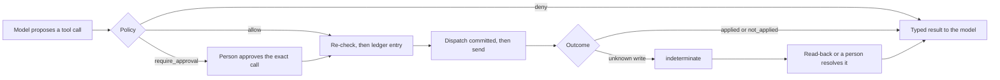

# Tether

Tether is a self-hostable, model-agnostic agent harness for executing consequential actions
against real systems safely. Its thesis: **models are swappable; the runtime is the product.**

The model decides what it wants to do. Tether decides whether, how and under what guarantees that
action may change the world.

## The problem

An agent that only talks can be wrong cheaply. An agent that calls tools which restart services,
create tickets or move money fails in ways an ordinary agent loop does not handle. A request
times out and the loop retries it, so a non-idempotent write happens twice. A person approves
"restart checkout", and the approval is used for a call with different arguments. A timeout is
reported to the model as a failure, the model tries again, and the first attempt had in fact
succeeded. A worker crashes between deciding to act and recording that it acted, and nobody can
say afterwards whether the effect happened. Tether is built around these failures.

## What makes it different

Tether runs the agent loop, but its purpose is the boundary between an agent's intent and a
side effect. Each item below is a mechanism, not a promise of good behaviour.

- **Ledger-first dispatch.** Before any byte leaves for a target, a ledger entry for that exact
  call exists and its dispatch record has committed. Every send carries a deterministic
  idempotency key; a non-idempotent write is never re-sent.
- **Exact-call approvals.** An approval is bound to one call by an HMAC over the RFC 8785
  canonical form of that call: workspace, run, agent, tool, pinned version and validated
  arguments. The approver is never the requester, and current policy is checked again before
  execution (implemented and tested; not yet a stated guarantee).
- **Honest unknown outcomes.** A write whose result is unknown becomes `indeterminate`, never
  "failed". A bounded, policy-authorized read-back or a person with a justification resolves it.
- **Crash-safe execution.** A PostgreSQL job queue with leases, a per-run advisory lock and
  fencing token, and audit events written in the same transaction as the state they describe.
  The LangGraph checkpoint is only a progress cache, and every replay is hash-checked.
- **A verifiable record.** Each run's audit events form an HMAC chain that `tether audit verify`
  recomputes, and every run can be reconstructed from PostgreSQL alone.

Tether is not a replacement for LangGraph or Temporal, a hosted service, a no-code builder, a
multi-agent framework, a prompt-injection detector or a sandbox for untrusted tool code.

## Architecture at a glance

One image runs two processes, `api` and `worker`. PostgreSQL is the only stateful dependency.
LangGraph provides graph mechanics; Tether's own tables are the record. One proposed tool call
travels this path:



- Each critical state change (decision, approval, authorization, dispatch, outcome, stop, final
  status) commits in one PostgreSQL transaction together with its audit event.
- The send happens only after the dispatch commit; jobs in the same database carry the work.
- The model only ever receives typed results; it never reaches a tool directly.

See the [architecture overview](docs/architecture/overview.md).

## The lifecycle of a governed action

1. A calling application submits a run with a workspace API key and the requester's token. The
   workspace comes from the API key and the requester from the token; the agent is one the key
   is bound to (named in the request only when the key is bound to several). Nothing in the
   request body identifies a person.
2. A worker leases the run's job, takes the run's advisory lock and fencing token, and asks the
   model for its next step through a provider adapter.
3. Each proposed tool call is validated against the tool's schema and decided by deny-by-default
   policy from trusted inputs only: `allow`, `deny` or `require_approval`.
4. For `require_approval`, the run waits without holding a process. An eligible approver, never
   the requester, approves the exact call.
5. Current policy and the approval are checked again. A ledger entry with a deterministic
   idempotency key is created, and the dispatch is committed before the tool is called.
6. The outcome is classified `applied`, `not_applied`, `unknown` or (for a read) `failed`. An
   unknown write becomes `indeterminate`, after any bounded same-key retry of an idempotent write,
   until a read-back or a reconciler settles it.
7. Every policy decision, approval request and decision, authorization, dispatch and outcome is
   in the run's audit chain, written in the same transaction as the change it records. The one
   exception is a refusal at the re-check just before execution (see Known limitations).

## Guarantees

The [guarantees page](docs/guarantees.md) states each one with its conditions and limits; the
guarantee card it links to is authoritative. The most important, proven by automated tests:

- No tool runs without a committed authorization record under the workspace's active policy
  version and a committed dispatch record, in that order.
- A non-idempotent write is sent at most once. Idempotent writes are re-sent only with the same
  key, within a bound, and never after a cancellation or deadline.
- An unknown outcome is never reported as a failure: the entry is `indeterminate`, and an
  eligible reconciler, never the requester, resolves it with a justification. (An automatic
  read-back may resolve the entry first; that verdict is implemented and tested but not part of
  this guarantee.)
- An approval is bound to exactly the call it was given and decided only by an eligible approver
  who is not the requester, once, before it expires.
- A crash right after a critical commit, during a model call, or with an idempotent write in
  flight loses no run and duplicates no idempotent write at a target that honours the key.
- Critical audit events are written inside the state-changing transaction and HMAC-chained per
  run; terminal run statuses never change.

Some behaviour is implemented and tested but not yet stated as a guarantee: automatic
verification of unknown outcomes, the policy re-check just before execution, lease heartbeats,
end-to-end masking of sensitive fields, and the OpenAI adapter. Do not rely on those as
guarantees yet.

## Validation

The live proofs below each ran once, on one development host, and are not part of CI. The
repeated chaos run was also a local run. No operating limit is published. Details are in [validation](docs/validation.md).

| Evidence | Result |
|---|---|
| Automated suites | 1,498 tests passed in a local run on one development host (2 skipped and 4 deselected: the live tests, never run in CI). CI then passed on the same code. |
| Live model run | The incident workflow ran end to end on the real OpenAI API (`gpt-4o-mini`) with real credentials: one approval-gated restart, applied once, with the approved call hash equal to the ledger's. |
| Live external write | Against a private GitHub sandbox repository, a real-model run created exactly one issue after its approval. The test failed once first, exposing a defect that was then fixed. It used a personal login rather than a least-privilege token, as a one-time exception. |
| Crashes around live calls | Every worker hard-killed and restarted in three cases around model calls and three around the external write. Every model-call case finished with one approval and one restart; every write case produced one issue. The non-idempotent create was never sent twice; the two interrupted creates were resolved by the tool's read-back. |
| Load, three workers | 300 scripted runs: all succeeded in 37 s. 300 scripted runs while every worker was killed and restarted nine times: all succeeded. 30 real-model runs: all succeeded in 33 s. No stuck run, dead job or duplicate effect. |
| Audit verification | `tether audit verify` reported `VALID` for every run of the validation, across both MAC versions. |
| Repeated chaos suite | 19 of 20 consecutive repetitions passed; the failure coincided with a host suspend. Not a clean 20 of 20. |

Load times are batch drain times on one host, not per-run latency and not limits. No PostgreSQL
restore drill has been performed.

## Quick start

You need Python 3.12, [uv](https://docs.astral.sh/uv/) and Docker with Compose v2.

```bash
uv sync --locked
cp deploy/compose/.env.example deploy/compose/.env   # replace every value; never commit it
uv run poe smoke                                     # build and start the development stack
uv run python scripts/smoke_submit.py                # submit a run, approve it, print the result
```

The development stack runs with `TETHER_ENV=dev`, the scripted model provider and a development
identity shortcut, none of which production accepts. [Getting started](docs/development/getting-started.md)
explains each value in `.env` and repeats the run with real tokens and an API key.

## An example workflow

The incident-remediation reference workload asks the agent to fix a failing `checkout` service.
The model reads the service's health (`get_service_health`, allowed by policy), then proposes
`restart_service`, which policy sends for approval. The run waits in `awaiting_approval`. An
approver lists pending approvals, sees the masked arguments and the call hash, and approves. The
worker re-checks policy and the approval, records the ledger entry and the dispatch, and sends
the restart once with its idempotency key. The run's audit chain then reads:

```text
RUN_SUBMITTED, POLICY_DECISION, EXECUTION_AUTHORIZED, DISPATCHED, TOOL_OUTCOME,
POLICY_DECISION, APPROVAL_REQUESTED, APPROVAL_DECIDED, EXECUTION_AUTHORIZED,
DISPATCHED, TOOL_OUTCOME, RUN_FINISHED
```

## Known limitations

- Each live proof ran once, on one host, and is not part of CI; CI exercises the OpenAI adapter
  and the GitHub client against mocked transports only.
- No operating limit (concurrency, latency, throughput, tool duration) is published.
- PostgreSQL is a single point of failure. No restore drill has been performed and recovery
  objectives are not set.
- Exactly-once is not claimed for arbitrary APIs. Idempotent re-sends rely on the target
  honouring the idempotency key. Run submission itself is not deduplicated.
- The audit chain detects modification and reordering within a run. It does not detect deletion
  of a chain's tail together with its head, or of a whole run, and it is not WORM storage. Events
  written before the MAC-version migration do not cover their timestamps.
- Production runs require a human end-user token. There are no production service principals and
  no OIDC or JWKS discovery.
- A refusal at the re-check just before execution writes no audit event of its own.
- Provider failover, Ollama, cost estimates, an approval UI, budgets, cross-run audit queries and
  key-lifecycle automation are not implemented.

## Documentation

| If you want to | Read |
|---|---|
| Find your way around | [Documentation index](docs/README.md) |
| Understand the design | [Architecture overview](docs/architecture/overview.md) |
| Know what is guaranteed | [Guarantees](docs/guarantees.md) and [validation](docs/validation.md) |
| Run and operate it | [Deployment](docs/operations/deployment.md) and [runbooks](docs/operations/runbooks.md) |
| Write a tool | [Writing a tool](docs/development/writing-a-tool.md) |
| Review its security | [Security model](docs/security/security-model.md) |
| Contribute | [Contributing](CONTRIBUTING.md) |

## Technology, status and licence

Python 3.12, FastAPI, Pydantic, LangGraph, PostgreSQL, OpenTelemetry and Docker.

Tether is at its first functional version and is pre-release (the package version is 0.0.0). No licence has been selected yet, so no rights to use
or redistribute the code are granted. To report a vulnerability, see the
[security policy](SECURITY.md).
