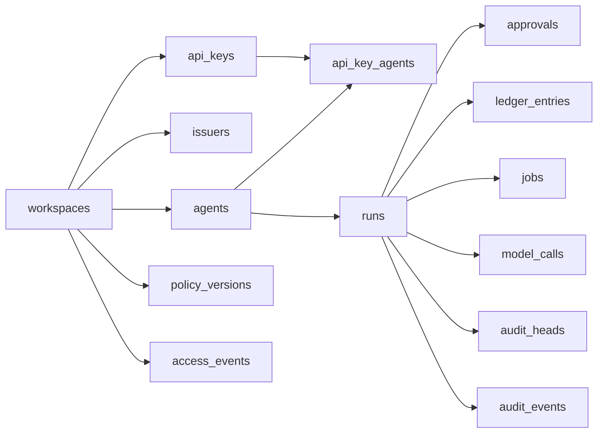

# Data model

This page describes what Tether stores in PostgreSQL and how it stays consistent: the tables, the
database roles and grants, workspace scoping in the schema, the unit of work, the transactions that
change state, the lock order, LangGraph checkpoints and migrations. It is for engineers and
operators who need to read the database, reason about concurrency, or plan an upgrade.

Tether's authoritative state lives in the `tether` schema. LangGraph's checkpoints live in a
separate `langgraph` schema and are a progress cache, not the record
([below](#checkpoints)).

## Tables

**Configuration**, written only by `tether bootstrap apply` as the migrator role
([ADR-0014](../adr/0014-bootstrap-config-no-admin-api.md)):

| Table | Holds |
|---|---|
| `tether.workspaces` | One row per workspace. |
| `tether.agents` | The agents configured in each workspace. |
| `tether.issuers` | Trusted JWT issuers per workspace: `iss`, allowed audiences, pinned algorithm (`EdDSA` or `RS256`), public keys only. |
| `tether.api_keys` | Workspace API keys as a salt and a SHA-256 hash; never the raw key. |
| `tether.api_key_agents` | Which agents each API key may submit runs for. |
| `tether.policy_versions` | Policy version identifiers per workspace, with at most one marked active. |

The policy rules themselves are not stored in the database. Each process loads them from the
bootstrap file; the database holds only the content hash of each version and which one is active.
Every policy decision checks, in its own transaction, that the version the process loaded is the
active one ([Policy](../governance/policy.md)).

**Runtime records**, written by the `api` and `worker` processes:

| Table | Holds |
|---|---|
| `tether.runs` | One row per run: workspace, agent, requester snapshot, task input, status, `outcome_summary`, stop fields (`cancel_requested_at`, `cancel_requested_by`, `deadline_at`, `deadline_exceeded_at`), the `driver_generation` fencing token, the pinned call-binding key id, and the run's trace context. |
| `tether.model_calls` | One row per model provider attempt: turn, provider, model, attempt, status (`succeeded` or `failed`), reported token usage, normalised error code, times. |
| `tether.approvals` | One row per approval request, unique per run and step ordinal: call hash, pinned tool and version, masked arguments and preconditions, status, expiry, decider, reason and the policy version that judged eligibility. |
| `tether.ledger_entries` | One row per authorized tool call, unique per run and step ordinal: pinned tool and version, effect, idempotency support, call hash, idempotency key, state, send attempts, masked output, outcome class and reason, resolution, resolver, justification, verification attempts and masked evidence. |
| `tether.jobs` | The job queue: kind, run, referenced row, payload, `run_after`, state, lease token and expiry, attempts and maximum, trace context ([Execution and recovery](execution-and-recovery.md#the-job-queue)). |

**Audit**:

| Table | Holds |
|---|---|
| `tether.audit_events` | The per-run audit chain: sequence number, dedupe key, event type, actor, tool, masked payload, policy version, time, MAC version, previous MAC, MAC and key id. |
| `tether.audit_heads` | One row per run: the last sequence number and MAC, and the audit key the run's chain uses. Appends lock it to serialise the chain. |
| `tether.access_events` | Who inspected which run through the approvals or ops audiences. Written asynchronously and best effort; not part of the audit chain. |

The audit chain, its events and its verification are explained in [Audit](../governance/audit.md);
ledger states and outcome classes in [Side effects and the ledger](../governance/side-effects-and-ledger.md).

Unmasked data is held by design in three places: the `execute_tool` and `verify_outcome` job
payloads, which hold the call arguments the worker needs to send the call; the LangGraph
checkpoint, which holds the model's proposals; and `runs.task_input`, which stores the submitted
task as received. Tool outputs are masked before they are persisted anywhere
([Secrets and data handling](../security/secrets-and-data-handling.md)).

Nothing is deleted. No retention policy exists yet; every run, event and job stays, so `jobs` and
`audit_events` grow without bound, and lease and heartbeat updates churn the rows of `jobs`.

### Constraints that carry meaning

The schema enforces, independently of application code:

- every status, state, kind, effect, resolution and outcome class is one of its allowed values
  (`CHECK` constraints);
- one approval and one ledger entry per run and step ordinal, so a replayed node can never create a
  second one;
- idempotency keys are unique and have the form `tth_` followed by 52 base32 characters; call
  hashes and MACs are 64 hexadecimal characters;
- a decided approval has a decider and a decision time, and a pending one has neither;
- a reconciled ledger entry has a resolver and a justification; a verified one has a resolver and
  masked evidence;
- an audit event's dedupe key is unique within its run, which makes every append create-or-get;
- a leased job has a lease token and expiry;
- a run's `cancel_requested_at` and `cancel_requested_by` are set together;
- at most one active policy version per workspace (a partial unique index).

**Terminal statuses never change.** A trigger, `runs_status_terminal_guard`, runs before any update
of `runs.status` and raises an error if the current status is `succeeded`, `failed`, `cancelled`,
`timed_out` or `abandoned` and the new one differs. Other columns stay writable, so a stop request
against a finished run is a harmless no-op. The application role cannot disable the trigger.

## Roles and grants

Two database roles are used. The **migrator** role owns both schemas and is used only by
`tether migrate` and `tether bootstrap apply`. The **application** role (`tether_app`) is used by
`api` and `worker` and has no DDL rights.

| Tables in `tether` | Application role may |
|---|---|
| `workspaces`, `agents`, `issuers`, `api_keys`, `api_key_agents`, `policy_versions` | Read. (A column grant on `policy_versions.created_at` exists only so the role can take share locks; it changes no policy data.) |
| `runs`, `approvals`, `ledger_entries`, `model_calls`, `audit_heads`, `jobs` | Read, insert, update. |
| `audit_events`, `access_events` | Read and insert only: append-only. |

The application role has **no `DELETE`** on any table in the `tether` schema. It can update runs,
approvals, ledger entries, model calls, audit heads and jobs; only audit events and access events
are insert-only. Runtime code moves rows between states and never removes them.

The `langgraph` schema is different. In the development stack, the database init script
(`deploy/compose/postgres/init.sh`) gives the application role default privileges there, including
`UPDATE` and `DELETE`, which the checkpoint saver uses. None of the append-only rules above apply to
checkpoints.

## Workspace scoping

Every runtime row carries a `workspace_id`, and the schema keeps related rows in one workspace:

- a run references its agent by `(workspace_id, agent_id)`, so a run cannot name another
  workspace's agent;
- approvals, ledger entries, jobs, model calls, audit heads and audit events reference their run by
  `(workspace_id, run_id)`, so a child row cannot point at a run in another workspace;
- an API key's agent bindings reference both the key and the agent within one workspace.

In code, a repository cannot be built without a `WorkspaceScope`. Every read it makes is filtered by
that workspace, and every write is stamped with it; a write for another workspace raises an error.
A row in another workspace is therefore simply not found, which the API returns as `404`. The API
builds the scope from the authenticated principal; the worker builds it from the job after checking
that the job and its run name the same workspace. The unscoped queries are the credential lookups
that establish the workspace and the queue functions (lease, heartbeat, complete, release and the
queue-depth sample), which act by job id across workspaces. Identity and isolation are
explained in [Authentication and authorization](../security/authentication-and-authorization.md).

## The unit of work

Every state change happens inside one `UnitOfWork`: one database connection and one transaction.
Entering it begins the transaction; leaving it commits, or rolls back if the block raised. Code
reaches tables only through repositories bound to that transaction. The transaction boundary
belongs to the code that performs the change (an API handler, a graph node, a job handler), never
to a repository.

Telemetry that must reflect committed state (metrics and some log lines) is registered with
`on_commit` and runs only after a successful commit. Such a callback can never affect the
transaction.

**The audit event is written in the same transaction as the state it describes**
([ADR-0015](../adr/0015-per-run-hmac-audit-and-authoritative-reconstruction.md)). An append locks the
run's `audit_heads` row, returns the existing event if its dedupe key is already present, and
otherwise reads the database clock, computes the MAC and inserts the next event. If the append
fails, the whole transaction rolls back and the state change does not happen. If the transaction
rolls back for any other reason, the event goes with it. For every transaction in the table below
that writes an audit event, the event and the state change commit together or not at all. The
transactions that write no event (the driver's claim, waiting statuses, model attempts, refusals
at the re-check before execution, and queue operations) are listed as such.

## Transactions

Each row is one transaction; everything in its last column commits together or not at all. Every
transaction that changes something a run is waiting for also enqueues its own `advance_run` wake.

| Transaction | Process | Commits atomically |
|---|---|---|
| Submit a run | `api` | Run row (`queued`, fixed deadline, binding key id), `RUN_SUBMITTED`, an `advance_run` job, a `run_deadline` job. |
| Lease, heartbeat, complete or release a job | `worker` | One update of the job row, conditional on its lease token. Not audited. |
| Claim the run | `worker` | Under the run's advisory lock: `driver_generation` + 1 and status → `running`, from any non-terminal status; skipped while a held run has unresolved entries. Not audited. |
| Record a model attempt | `worker` | One `model_calls` row, written after the provider responds, with a fencing-token check in the same transaction. Not audited. |
| Decide on a proposal | `worker` | `POLICY_DECISION` (with call hash and pinned version) or `CALL_INVALID`. The event is the decision record. |
| Request approval | `worker` | Approval row, `APPROVAL_REQUESTED`, an `expire_approval` job. |
| Decide an approval | `api` | Approval `pending → approved` or `rejected` (only while unexpired, and only if the run is neither stopped nor terminal), `APPROVAL_DECIDED`, a wake. |
| Authorize execution | `worker` | Ledger entry `pending` with its idempotency key, `EXECUTION_AUTHORIZED`, an `execute_tool` job carrying the validated arguments. |
| Dispatch | `worker` | Entry `pending → dispatched` (or attempts + 1 for a re-send), `DISPATCHED` or `REDISPATCHED`. Committed before the external call. When the gate refuses, the refusal's outcome, `TOOL_OUTCOME` and a wake instead. |
| Record the outcome | `worker` | Entry `dispatched →` `completed`, `failed` or `indeterminate`, with masked output, outcome class and reason; `TOOL_OUTCOME`; a wake; a `verify_outcome` job if the entry became `indeterminate` and its tool declares a read-back. |
| Verification gate and result | `worker` | Before a probe: verification attempts + 1 and `VERIFICATION_ATTEMPTED`, or the end of verification. After: the entry resolved `verified_applied` or `verified_not_applied` with evidence and `VERIFIED`, or `VERIFICATION_INCONCLUSIVE`, or `VERIFICATION_LATE` if a person resolved it first ([Unknown outcomes](../governance/unknown-outcomes.md)). |
| Reconcile | `api` | Entry `indeterminate → completed`, `failed` or `abandoned`, with resolution, resolver and justification; `RECONCILED`; a wake. |
| Cancel | `api` | `cancel_requested_at` and `cancel_requested_by`, every pending approval `closed`, `CANCEL_REQUESTED` and one `APPROVAL_CLOSED` each, a wake. |
| Deadline passed | `worker` timer | `deadline_exceeded_at`, pending approvals closed, `DEADLINE_EXCEEDED` and `APPROVAL_CLOSED` each, a wake. |
| Expire an approval | `worker` timer | Approval `pending → expired` (only once its expiry has passed), `APPROVAL_EXPIRED`, a wake. |
| Skip the rest of a turn | `worker` | One `CALL_SKIPPED` per remaining call. |
| Record a replay divergence | `worker` | `REPLAY_DIVERGENCE` and nothing else. |
| Wait | `worker` | `runs.status` to an `awaiting_*` status. Not audited. |
| Finish | `worker` | Terminal status, `outcome_summary`, `RUN_FINISHED`. |
| Dead-letter | `worker` | The job `dead`, the kind's domain outcome and audit event, a wake ([Execution and recovery](execution-and-recovery.md#dead-letter)). |

The ordering that matters most: no external call is reachable unless the authorization and then the
dispatch have both committed. The model provider is called outside any transaction, and so is a
tool.

A refusal at the re-check before execution (a policy that now denies, a changed call, an approval
that no longer matches or has lapsed) writes no ledger entry and no audit event of its own; the
model receives a typed result.

## Lock order

Transactions that lock more than one row take their locks in one global order:

**run row → approval or ledger row → active policy version → audit head → jobs**

Following this order prevents two transactions from waiting on each other in a cycle. Inserting a row whose
foreign key references the run locks the run row implicitly, so transactions that
append audit events or enqueue jobs take the run row explicitly first. The outcome commit, for
example, share-locks the run row before it touches the ledger and the audit head; without that, it
would deadlock with a concurrent cancel holding the run row and waiting for the audit head.
`tests/integration/test_lock_order.py` holds this ordering for the outcome and verification commits.

The lock modes on the run row express who may proceed concurrently:

- **Graph write nodes** (decisions, approval requests, authorization, skips, finish) and the
  `execute_tool` and `verify_outcome` transactions take the run row `FOR SHARE`. Many can hold it
  at once.
- **Cancel, deadline and approval expiry** take the run row `FOR UPDATE`. A stop therefore waits for
  every in-progress write node to commit, and every write node that starts after the stop commits
  sees it. That is what makes "no new decision or authorization after a stop" exact rather than
  timing-dependent.
- **Approval decisions and reconciliations** take the run row `FOR SHARE` and their own approval or
  ledger row `FOR UPDATE`, then check that the row is still in the state they expect.

The dispatch gate is the one exception: it locks the ledger entry `FOR UPDATE` first and then
share-locks the run row. It cannot form a cycle: every transaction that locks a ledger row holds
the run row only `FOR SHARE`, and the transactions that take the run row `FOR UPDATE` (cancel,
deadline, approval expiry) never lock a ledger row. If PostgreSQL ever detects a deadlock anyway,
it aborts one of the transactions, which rolls back completely; a worker transaction is then
retried by redelivery, and an API request fails and can be repeated.

Time comparisons use `clock_timestamp()`, the database clock at the moment of the statement, not
the transaction start time and not a process clock.

## Checkpoints

LangGraph's checkpoint saver keeps its tables in the `langgraph` schema
([ADR-0003](../adr/0003-authoritative-tables-checkpoint-progress-cache.md)). `tether migrate` creates
them, as the migrator role. At run time the worker reaches them through a dedicated connection pool
whose `search_path` is `langgraph`; Tether code never writes them directly. Each run is one
LangGraph thread, keyed by the run's id.

The graph is invoked with `durability="sync"`, so each step's checkpoint is durable before the next
node runs. The checkpoint records where the graph is: the message history, the remaining proposals
of the turn, step ordinals and counters. It supplies only the graph's position and the model's
proposals. Whether a decision, approval or ledger entry exists, and what it says, is read from the
`tether` tables, and every reuse of a persisted row is checked against the hash of the
checkpoint's call. A replay that would adopt a row for a different call fails closed ([Run lifecycle](run-lifecycle.md#replay-and-replay-divergence)). The
checkpoint save is not part of any Tether transaction and is not fenced; that is why every adoption
of persisted state is hash-checked.

Checkpoints are keyed by run id only and carry no workspace column. They are read only by the run
driver, never by the API.

## Migrations

`tether migrate` applies the `tether` schema migrations with Alembic and then sets up the LangGraph
saver's tables. It is idempotent. The migrations, in order:

| File | Change |
|---|---|
| `rev_0001_baseline.py` | Empty starting revision; the schemas and roles come from the database's init script. |
| `rev_0002_core_schema.py` | All fourteen tables, their constraints, the terminal-status trigger and the application role's grants. |
| `rev_0003_audit_mac_version.py` | `audit_events.mac_version`. Existing events are version 1; the column has no default afterwards, so every new event states its version. |
| `rev_0004_ledger_outcome_class.py` | Nullable `ledger_entries.outcome_class`. Older entries stay unclassified. |
| `rev_0005_ledger_verification.py` | `verification_attempts`, `verification_evidence_masked`, the `verified_applied` and `verified_not_applied` resolutions, and the `verify_outcome` job kind. |

The application and the schema are deployed as a compatible pair. **Do not run old and new `api` or
`worker` processes against the same database across a migration that changes what writers must
write.** For `0003` and `0005`: drain and stop every old process, run `tether migrate`, then start the
new version. An old writer against `0003` fails closed: its audit append is refused and its whole
transaction rolls back. Downgrading below `0003` once version-2 audit events exist, or below `0005`
once a verified resolution or a `verify_outcome` job exists, is not a production rollback. The
procedure and the reasons are in [Production configuration](../operations/production-configuration.md)
and [Deployment](../operations/deployment.md).

## Related

- [Execution and recovery](execution-and-recovery.md): the job queue and crash recovery.
- [Run lifecycle](run-lifecycle.md): which graph node performs each transaction.
- [Audit](../governance/audit.md): the audit chain's construction and verification.
- [PostgreSQL recovery](../operations/postgres-recovery.md): backups, restores and the recovery
  discontinuity.
- [Design history](tether-v1-architecture.md): the original design record.
