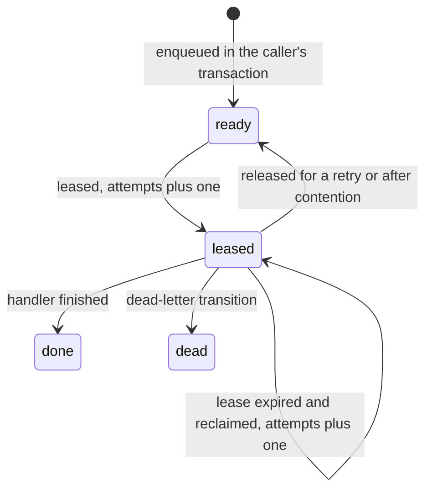

# Execution and recovery

This page explains how Tether gets work done and how that work survives crashes: the PostgreSQL
job queue, leases and heartbeats, attempt budgets and backoff, the dead-letter transition, the run
driver's lock and fencing token, and what happens when a worker dies at each interesting moment.
It is for engineers who need to reason about Tether under failure and for operators diagnosing a
stuck or failed run.

Two rules carry most of the weight. Work is delivered **at least once**, so every job kind is
written to be safe when it runs twice. And every fact about the outside world is committed to
PostgreSQL **before** the action that depends on it, so a restarted worker can always decide from
the record what may and may not happen next.

## The job queue

Jobs are rows in the `tether.jobs` table, in the same database as everything else
([ADR-0004](../adr/0004-postgres-job-queue.md)). A job is enqueued inside the transaction that
creates the work, so a job exists exactly when the state change that needs it has committed: the
table is its own transactional outbox.

| Job kind | Enqueued by | What it does |
|---|---|---|
| `advance_run` | Submission, and every transaction that changes something a run waits for (a tool outcome, an approval decision or expiry, a reconciliation, a verification result, a stop) | Drives the run graph once. |
| `execute_tool` | Authorization of a call (the ledger entry's creation) | Dispatches one tool call and records its outcome. |
| `verify_outcome` | The transaction that makes a write `indeterminate`, if its tool declares a read-back | Runs one read-back probe ([Unknown outcomes](../governance/unknown-outcomes.md)). |
| `run_deadline` | Submission, due at the run's `deadline_at` | Records that the deadline passed. |
| `expire_approval` | An approval request, due at its `expires_at` | Moves a still-pending approval to `expired`. |

A job is in one of four states: `ready`, `leased`, `done` or `dead`. Jobs are never deleted.

**Wake jobs are never coalesced.** Every state-changing transaction inserts its own
`advance_run`, even if one is already queued. A duplicate wake is a harmless no-op; a coalesced
wake could be consumed by a worker before the change that needed it commits, and strand the run.

**Timers are delayed jobs**: a `run_after` in the future. A late timer never lets an expired
approval or a passed deadline be acted on: both are also enforced wherever a decision is made, by
comparing the database clock with the stored `expires_at` or `deadline_at`. But the timer is what
makes the change visible and wakes the run. In particular, the deadline timer is what closes a
run's pending approvals; until it runs, a run waiting on an approval ends only when that
approval's own expiry timer wakes it.

There is no `LISTEN/NOTIFY`. Each worker polls every `TETHER_WORKER_POLL_INTERVAL_SECONDS` and, while
the database is reachable, processes due jobs one at a time until none is left. A worker process
runs one job at a time; throughput scales with the number of worker processes. Leasing is
first-in-first-out by `run_after` across all workspaces, with no fairness between workspaces and
no priority.

The `jobs` table grows without bound, since jobs are never deleted, and lease and heartbeat
updates churn its rows.

### Leasing

A worker leases one job at a time with a single statement: it selects the due job with the
earliest `run_after`, either
`ready` with `run_after` in the past or `leased` with an expired lease, using `FOR UPDATE SKIP
LOCKED`, and in the same statement sets a new random lease token, a lease expiry and
`attempts = attempts + 1`. `SKIP LOCKED` means two workers polling at once never lease the same
job. The lease spans workspaces by design; the handler then builds a workspace scope from the job
and refuses it if the job and its run disagree about the workspace.

Completing a job (`done`) and releasing it back to `ready` are both conditional on the lease token.
A worker that has lost its lease can neither complete nor release the job.

### Lease heartbeats

While a handler runs, the worker extends its lease every `TETHER_WORKER_LEASE_HEARTBEAT_SECONDS`
(by default a third of the lease). A beat is conditional on the lease token, so it changes nothing
for a worker that lost the job. A healthy tool call that takes longer than the lease is therefore
neither redelivered nor treated as unknown.

If a beat finds the lease gone, or no beat has succeeded for a whole lease (for example, the
database was unreachable), the worker cancels the handler and treats it as its own death: it
neither completes nor releases the job, and whatever the handler had not committed did not
happen. The next delivery decides from the ledger, as in the crash table below.

Limits of this mechanism:

- A handler must yield to the event loop. A synchronous, blocking tool handler starves the heartbeat
  and loses its lease.
- A beat checks the lease token and the `leased` state, not the expiry time, so a worker whose lease
  expired but was not yet reclaimed can still extend it.
- There is no maximum total extension. Each tool send is still bounded by the tool's
  `timeout_seconds` (default 10 s, at most 300 s); a send that times out has an unknown outcome.
- Loss is detected on the worker's own clock and can trail the database's view of the expiry by a
  beat's round trip. An aborted handler stops only at its next `await`, so a second delivery can
  briefly overlap it. Conditional ledger updates, not the lease, keep that overlap safe.

Heartbeats are implemented and tested, but their behaviour is not yet one of the proven guarantees
([Guarantees](../guarantees.md)).

### Attempts and backoff

Three different budgets share the name `max_attempts`: deliveries per job (below), sends per tool
call (on the tool's descriptor), and probes per unknown outcome (on the tool's verification
declaration). They are counted separately.

Every lease adds one attempt to the job. Each kind has a fixed delivery budget:

| Job kind | `max_attempts` |
|---|---|
| `advance_run` | 8 |
| `execute_tool` | 5 |
| `verify_outcome` | 5 |
| `run_deadline`, `expire_approval` | 10 |

Not every release spends an attempt. For an `advance_run` job:

- **Contended.** If another session holds the run's advisory lock, the worker releases the job to
  run again after 1 s and refunds the attempt.
- **Stale policy.** If the policy the worker loaded at startup is no longer the workspace's active
  version, the decision node raises before writing. The run stays `running` (the claim and any
  earlier nodes have already committed), the job is released after 1 s, and the attempt is
  refunded; a worker with the current policy picks it up.
- **Fenced.** If a newer driver took over, the job is released immediately and the attempt stays
  spent.

Contended and stale-policy releases have no bound. While every worker's policy is stale, or while
another session holds the run's lock, the job cycles indefinitely without dead-lettering, and the
run shows `running`.

A tool call that must be re-sent is released with a delay as its `run_after`: full jitter, ceiling
0.5 s doubling per send, capped at 5 s. A verification probe that was inconclusive is released with
the backoff its tool declares. A handler that raises an unexpected error keeps its lease; the job is
redelivered when the lease expires, and that delivery spends an attempt.

### Dead-letter

A lease that takes a job past its `max_attempts` does not run the handler. It runs the kind's
**dead-letter transition**, which marks the job `dead` in the same transaction as a domain outcome
and a wake. Exhaustion therefore never strands a run with an unresolved effect. If the lease is no
longer current, the whole transaction rolls back.

| Job kind | Dead-letter outcome |
|---|---|
| `execute_tool` | Nothing is sent. A `pending` entry becomes `failed`, classified `not_applied` (it never left Tether). A `dispatched` write becomes `indeterminate`, with a verification job if its tool declares a read-back. A `dispatched` read becomes a typed failure, classified `unknown`. `TOOL_OUTCOME` and a wake. |
| `advance_run` | Under the run's advisory lock with a fresh fencing token: the run moves to `awaiting_reconciliation` if any ledger entry is `pending`, `dispatched` or `indeterminate`, otherwise to `failed` with summary `system_error`. `DEAD_LETTERED`, plus `RUN_FINISHED` when the run becomes terminal, and a wake. If the lock is held elsewhere, the transition is retried after 1 s without spending an attempt. A held run is not failed: when its hold clears it resumes, and if the cause persists it dead-letters again and ends `failed` with `system_error`. |
| `verify_outcome` | Automatic verification ends with `VERIFICATION_EXHAUSTED` (reason `delivery_exhausted`); the entry stays `indeterminate` for a reconciler. A wake. |
| `run_deadline`, `expire_approval` | Marked `dead` with a wake. Their condition is still enforced at decision time. |

The `tether.jobs.dead_lettered` metric counts these ([Observability](../operations/observability.md)).

## Run driver lock and fencing token

At-least-once delivery and uncoalesced wakes mean two workers can hold `advance_run` jobs for the
same run at once. Two concurrent drivers would make different model calls from the same step
ordinals. A per-job lease cannot prevent this, because duplicate jobs have different leases.
Tether serialises run driving with two mechanisms
([ADR-0005](../adr/0005-run-driver-mutex-and-fencing.md)).

1. **Advisory lock.** After leasing an `advance_run` job, the worker tries a session-level
   PostgreSQL advisory lock named after the run, on a dedicated connection held for the whole
   invocation. If another driver holds it, the job goes back to `ready` after 1 s without spending
   an attempt.
2. **Fencing token.** With the lock held, the driver increments the run's `driver_generation`
   and keeps the new value. Every authoritative write the driver makes (decisions, approval
   requests, ledger entries, skip events, divergence events, status changes) share-locks the run row
   and checks that `driver_generation` still equals its token, in the same transaction as the
   write. On a mismatch the transaction rolls back and the invocation stops.

The lock alone is not enough. If PostgreSQL ends the lock's session (immediately on a clean
disconnect, or only after TCP keepalive detection on a network partition), it releases the lock,
but the old driver's code may keep running until it notices: a **zombie driver**. A new driver can take the
lock and a new token in that window. The zombie's next write then fails the token check, so it
cannot finalise a run the live driver is still working on, or record a decision from a different
model response.

One window remains. The lock can be lost after a node's last fenced write but before LangGraph
writes that node's checkpoint, which Tether cannot fence. A stale checkpoint written in that window
can make a later replay disagree with the record; the hash check on replay detects this and the run
fails closed ([Run lifecycle](run-lifecycle.md#replay-and-replay-divergence)). No side effect is
reachable without a fenced authorization followed by a dispatch that is conditional on the ledger
entry's state.

API transactions (approval decisions, reconciliations, cancellations) and tool-execution
transactions are not driver writes and are not fenced. They are serialised by row locks and by
updates that are conditional on the current state ([Data model](data-model.md#lock-order)).

## Executing a tool call

The `execute_tool` handler is the only place a tool's side effect happens. Each delivery:

1. **Gate, committed before any send.** Lock the ledger entry, share-lock the run. Resolve exactly
   the tool version the entry pinned. Re-validate the job's arguments and recompute their call hash;
   it must equal the ledger's. Check the stop predicate and whether the run has a recorded replay
   divergence. Then:
   - a `pending` entry is dispatched only if the stop predicate is false, no divergence is
     recorded, the pinned version resolves and the call hash matches. It becomes `dispatched`
     (attempt 1) with a `DISPATCHED` event. Otherwise it becomes `failed`, classified
     `not_applied`, with `TOOL_OUTCOME` and a wake, and nothing is sent;
   - a `dispatched` entry, which means an earlier send's outcome is unknown, is re-sent only if it
     is idempotent, the run is not stopped or diverged, and the tool's send budget is not spent.
     The gate records attempt n+1 with a `REDISPATCHED` event. Otherwise it records the unknown
     outcome as final;
   - a terminal entry means the work is done: nothing is sent.
2. **Send.** Call the tool's handler with the entry's stored idempotency key, under the tool's
   `timeout_seconds`.
3. **Outcome, committed after the send.** Share-lock the run, then record the masked, classified
   outcome on the entry (only if it is still `dispatched`), with `TOOL_OUTCOME` and a wake. If the
   entry is no longer `dispatched` (a newer delivery already recorded an outcome), the result is
   discarded without an audit event.

Outcome classification, idempotency keys and the rules for re-sending a tool call are explained in
[Side effects and the ledger](../governance/side-effects-and-ledger.md). In short, a read or an
idempotent write whose outcome is unknown is re-sent with the same key, within the tool's send
budget and never after a stop; a non-idempotent write is never re-sent.

## What is retried

Apart from tool sends, covered by the governance page above:

| Work | Retried? | Bound |
|---|---|---|
| A model call | Only errors the provider adapter marks retryable | `TETHER_PROVIDER_MAX_ATTEMPTS` per turn (default 3) |
| An `advance_run` delivery | Yes, on lease expiry; every replay is safe | 8 deliveries, then dead-letter |
| A verification probe | Yes, while inconclusive, never after a stop | The tool's declared probe count (default 3); 5 deliveries |
| A timer | Yes; idempotent conditional update | 10 deliveries |
| A denied, rejected or expired call | No. The model sees the typed result and may propose again, as a new call | |

An idempotent re-send relies on the target honouring the key. If a lease is lost while a send is
still in flight, two sends with the same key can overlap; applying once is then the target's
deduplication, not Tether's.

Run submission is not deduplicated: `POST /v1/tasks/runs` takes no client idempotency key, so a
client that retries after losing the response creates a second run.

## What a crash does

A transaction is either committed or absent; there is no partial state. The table lists what is
persisted when a worker or the API process dies at each point, and what the next delivery does. "Lease expiry" means the dead worker's
lease runs out (by default after up to 60 s) and another worker leases the job.

| Crash point | What is persisted | What happens on recovery |
|---|---|---|
| API, during a submission | All of the run, its first audit event and its two jobs, or none of them | Nothing to recover. Submission is not idempotent: a client that retries after losing the response creates a second run. |
| Worker, during a model call | The checkpoint before the call; no `model_calls` row for the interrupted attempt | After lease expiry, the driver recovers from the checkpoint and calls the model again. The lost response's proposals never existed. |
| Worker, after a model attempt's row commits, before the checkpoint | The `model_calls` row | The model is called again; both attempts are recorded. An attempt interrupted by a crash before its row committed, or made by a driver that has since been fenced, is not recorded. |
| Worker, after a write node commits (decision, approval, ledger entry, skip events), before its checkpoint | The row and its audit event | The node replays, finds the row by its deterministic key, checks the call hash, and adopts it. Same outcome, no duplicate. |
| Worker, after the ledger entry is created, before `execute_tool` runs | Entry `pending`, `execute_tool` job `ready` | Any worker leases the job and runs the dispatch gate. |
| `execute_tool`, before the dispatch commit | Entry `pending` | Redelivery runs the gate again: the entry is dispatched only if the stop predicate is false, no divergence is recorded, the pinned version resolves and the call hash matches; otherwise it becomes `failed`, classified `not_applied`, and nothing is sent. If the job's deliveries run out first, the dead-letter transition records `not_applied`; nothing was sent. |
| `execute_tool`, after the dispatch commit, before or during the send: **idempotent write or read** | Entry `dispatched`, `DISPATCHED` | Redelivery commits `REDISPATCHED` and re-sends with the same key, unless the run has stopped or the budget is spent; then the outcome is unknown: `indeterminate` for a write, a typed failure for a read. |
| Same point: **non-idempotent write** | Entry `dispatched`, `DISPATCHED` | Redelivery sends nothing and records `indeterminate` (`outcome unknown after redelivery; not re-sent`). Tether cannot tell whether the first send reached the target, so a non-idempotent write can be `indeterminate` although nothing was ever sent: a crash between the dispatch commit and the send has that result. Automatic verification runs if the tool declares a read-back; otherwise a reconciler decides. |
| `execute_tool`, after the send returned, before the outcome commit | Entry `dispatched` | As the two rows above. The target already applied the write: an idempotent re-send is deduplicated by the target; a non-idempotent write becomes `indeterminate`, and a read-back would find it applied. |
| `execute_tool`, after the outcome commit, before the job is marked done | Entry terminal, wake job enqueued | Redelivery finds the entry terminal, sends nothing, and completes the job. |
| Driver loses its lock connection but keeps running | A newer driver may hold the lock and a newer token | The zombie's next write fails the token check and rolls back; it stops. |
| Database unreachable | Nothing new | No beat succeeds; after a whole lease the handler aborts. Nothing progresses and nothing committed is lost. A send already in flight may still reach the target; its result cannot be committed and is lost. On recovery, a non-idempotent write becomes `indeterminate` and an idempotent one is re-sent. |

A non-idempotent write is never sent twice by Tether. An idempotent write in flight during a crash
is applied once by a target that honours its key. No run is lost: its jobs are redelivered until
they finish, dead-letter into a domain outcome, or, for contended or stale-policy `advance_run`
jobs, cycle until the lock frees or a worker with the current policy takes them.

These cases are exercised by the chaos suite under `tests/chaos/`: a crash right after each
critical commit, a crash during a model call, crashes with idempotent and non-idempotent writes in
flight, a send budget spent by crashes, repeated crashes of `advance_run` and `execute_tool` until
dead-letter, a diverged replay after a crash, heartbeat loss, and real `api` and `worker` processes
hard-killed and restarted mid-run ([Testing](../development/testing.md)).

## Competing workers

Any number of workers can serve the same database. They need no coordination beyond PostgreSQL:

- `SKIP LOCKED` gives each due job to one worker.
- Duplicate `advance_run` jobs for one run meet at the advisory lock: one worker drives, the others
  release their job without spending an attempt, and their later deliveries find nothing to do.
- A tool call has one ledger entry and one `execute_tool` job; its dispatch and outcome are
  conditional updates on the entry's state, so a late result from a worker that lost its lease
  cannot overwrite the record a newer worker wrote. The late result is discarded without an audit
  event, so a read-back or a person must settle the entry without it.
- Timers and stop requests are conditional updates under the run row's lock and are no-ops when
  already applied.

The chaos suite races three workers for one run fifty times, drains fifty runs with four workers,
and checks that each run's write is sent once and its model is called the expected number of times.

## Defaults

These are development defaults from `src/tether/settings.py` and the job definitions. They are not
operating limits; no operating limit is published ([Validation](../validation.md)).

| Setting | Default | Effect |
|---|---|---|
| `TETHER_WORKER_LEASE_SECONDS` | 60 | How long a leased job stays invisible to other workers without a beat. |
| `TETHER_WORKER_LEASE_HEARTBEAT_SECONDS` | unset: a third of the lease (20 s) | How often the lease is extended. Must be below the lease. |
| `TETHER_WORKER_POLL_INTERVAL_SECONDS` | 1.0 | How long an idle worker waits before polling again. |
| `TETHER_WORKER_HEARTBEAT_MAX_AGE_SECONDS` | 30 | How stale the worker's heartbeat file may be before its container healthcheck fails. The worker touches the file once per poll cycle, before it drains due jobs, so a single job or a backlog that takes longer than this setting also makes the file stale, as does an unreachable database. Use the check for alerting, not as a liveness restart, unless the setting exceeds your longest job. |
| `TETHER_PROVIDER_MAX_ATTEMPTS` | 3 | Model attempts per turn. |
| Tool `max_attempts` | 3 | Sends per tool call (set on the tool's descriptor). |
| Tool `timeout_seconds` | 10 | Per send; at most 300. |
| Job `max_attempts` | 8, 5, 5, 10 | `advance_run`, `execute_tool`, `verify_outcome`, timers. Fixed in code. |

Every setting is described in [Configuration](../operations/configuration.md).

## Related

- [Run lifecycle](run-lifecycle.md): what the driver does with a run once it holds it.
- [Data model](data-model.md): the transactions and the lock order.
- [Side effects and the ledger](../governance/side-effects-and-ledger.md): outcome classes and
  idempotency keys.
- [Runbooks](../operations/runbooks.md): diagnosing stuck, held or dead-lettered work.
- [Design history](tether-v1-architecture.md): the original design record.
