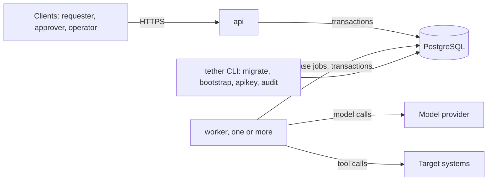
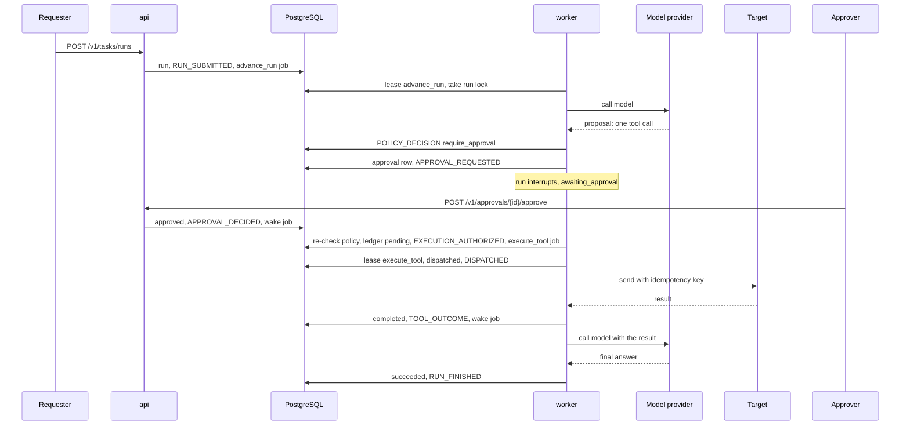

# Architecture overview

This page is the map of Tether: its processes, its one stateful store, the layers of its code,
and the path one consequential action takes from request to audit. It is for engineers who need
to reason about the system before reading the code.

Tether is a self-hostable, model-agnostic agent harness. It runs the agent loop (model calls,
run state, tool governance, dispatch and outcomes), but its purpose is the boundary between what
an agent intends and what actually changes in a real system. The model decides what it wants to
do; Tether decides whether, how and under what guarantees that action may change the world.

Every consequential action crosses one governed path: identity, policy, exact-action human
approval when policy requires it, authorization against current policy, dispatch, execution,
outcome classification, a retry or idempotency decision, verification or human reconciliation
when the outcome is unknown, and audit. Nothing in the system reaches a tool any other way.

## Processes and the store

Tether ships as one container image with two long-running entrypoints, `tether-api` and
`tether-worker`, plus a one-shot `tether migrate`. PostgreSQL is the only stateful dependency.

| Process | What it does | What it never does |
|---|---|---|
| `api` | Authenticates the request, authorizes it against the route's audience and the caller's workspace, records intent in one transaction (a run submission, an approval decision, a reconciliation, a cancellation) and enqueues a job in that same transaction. Serves run inspection. | Run graph nodes, call a model, execute a tool. |
| `worker` | Leases jobs from the queue and runs them: driving a run through its graph (model calls, policy, approvals), executing tools, verifying unknown outcomes, and firing timers. Scales by adding replicas. | Accept HTTP requests. |
| `tether migrate` | Applies the `tether` schema migrations and creates the LangGraph checkpoint tables, as the migrator database role. Idempotent. | Run at the same time as an older `api` or `worker` across a schema change (see [Data model](data-model.md#migrations)). |

Both long-running processes are stateless. Every fact that matters is in PostgreSQL, so either
process can be killed at any instruction and restarted; [Execution and
recovery](execution-and-recovery.md) shows what happens at each point.

**Why PostgreSQL is the only stateful dependency** ([ADR-0001](../adr/0001-two-process-topology-postgres-only.md)).
Tether's core safety argument is that no side effect happens without a committed policy decision,
ledger entry and audit event. That argument is simplest when those records and the dispatch of
work commit in one database transaction. The job queue is a table in the same database, so
"create the ledger entry, write the audit event, enqueue the tool job" is one atomic commit. A
separate broker such as Redis or RabbitMQ would split that transaction and require an outbox
relay. There is no Redis, no broker, no Temporal and no Kubernetes requirement.

The cost is that PostgreSQL is a single point of failure. While it is down, nothing progresses
and nothing committed is lost. Every guarantee assumes committed history is never rolled
backward; a restore that loses committed state is a recovery discontinuity
([PostgreSQL recovery](../operations/postgres-recovery.md)).

The process boundary between `api` and `worker` is not a sandbox. Run driving and trusted tool
code share the worker process; Tether does not isolate untrusted tool code.

## What Tether owns and what LangGraph owns

Tether builds on LangGraph for graph mechanics and does not reimplement them
([ADR-0003](../adr/0003-authoritative-tables-checkpoint-progress-cache.md)).

| LangGraph owns | Tether owns |
|---|---|
| Graph execution, node ordering, routing | The graph's nodes and what each may write |
| Checkpoints of graph state, in the `langgraph` schema | The authoritative tables in the `tether` schema: runs, approvals, ledger, audit, jobs |
| Interrupts and resume | When to interrupt, and what wakes a run (a job, never a resume payload) |
| Replay of a node after a crash | Making replay safe: create-or-get by deterministic key, with a call-hash check |

The rule is short: **LangGraph decides where the graph is; Tether tables decide what has happened
in the world.** The checkpoint is a progress cache. No side-effect decision reads it, the API never
reads it, and Tether never writes the `langgraph` schema directly. Run inspection reads only
Tether tables. The run graph is invoked with synchronous durability, so each step's checkpoint is
durable before the next node can create an authoritative row. [Run lifecycle](run-lifecycle.md)
describes the graph and its replay rules.

## Core, SDK and workloads

Tether's code is split into three layers ([ADR-0002](../adr/0002-core-sdk-workload-layering.md)).

- **Core** (`src/tether/`) is the runtime.
- **SDK** (`tether.sdk`) is the only module a workload may import. It defines the tool contract
  (`ToolDescriptor`, `ToolNotApplied`, `Sensitive`, `VerifyDeclaration` and related types), the
  agent definition and the `Workload` that bundles them.
- **Workloads** (`workloads/`) are clients of Tether: packages of tools and an agent definition.
  Two reference workloads exist: incident remediation, against a small demo target service, and
  repository change control, against GitHub issues.

Two import contracts in `pyproject.toml` are checked on every CI run: the core must not import
`workloads`, and a workload may import nothing from Tether except `tether.sdk`. An architecture
test also fails if any workload-specific name appears in the core. Workloads are discovered at
startup through the `tether.workloads` entry-point group, named by the bootstrap file, never
imported statically. A worker refuses to start if a configured workload is missing or fails to
load, if a policy allows a high-risk tool, or if an approval expiry exceeds the configured maximum;
a partially loaded registry never serves.

The production image is built without the incident-remediation workload, the scripted model
provider and the scenario files ([Deployment](../operations/deployment.md)).

## The path of one consequential action

The diagram follows a run whose model proposes one write that policy says needs approval. Every
arrow into PostgreSQL is one transaction, and every such transaction writes its audit event in the
same commit as the state it describes.

1. **Submission.** The `api` validates the requester's JWT and the workspace API key, then commits
   the run row (status `queued`, a fixed deadline, a pinned call-binding key), the first audit
   event `RUN_SUBMITTED`, an `advance_run` job and a `run_deadline` timer job, all or nothing.
   The workspace and agent come from the credentials, never from the request body
   ([Authentication and authorization](../security/authentication-and-authorization.md)).
2. **Driving the run.** A worker leases the `advance_run` job, takes the run's advisory lock and
   a fresh fencing token, and invokes the run graph. The graph calls the model provider through
   the provider adapter ([Model providers](../operations/model-providers.md)).
3. **Governance.** Each proposed tool call is validated against the tool's input schema and
   evaluated by the policy engine using trusted inputs only: the requester, the agent, the
   workspace and the tool's registered metadata, never the model's text or arguments. The
   decision (`allow`, `deny` or `require_approval`) and the keyed call hash are recorded as a
   `POLICY_DECISION` event ([Policy](../governance/policy.md)).
4. **Approval.** For `require_approval`, the graph creates an approval bound to the exact call
   hash, schedules its expiry timer and interrupts. No process waits: the run sits in
   `awaiting_approval` until a job wakes it. An eligible approver, never the requester, decides
   through the API; the decision commits with a wake job ([Approvals](../governance/approvals.md)).
5. **Authorization.** The graph re-evaluates the call against the policy that is current now and
   checks the approval still matches the call hash and has not lapsed. Only then does it create
   the ledger entry (`pending`), with a deterministic idempotency key, and enqueue `execute_tool`.
6. **Dispatch and execution.** A worker leases `execute_tool`, re-checks the arguments against the
   ledger's call hash and the stop predicate, and commits `pending → dispatched` with a
   `DISPATCHED` event **before** the external call. It then calls the tool's handler under the
   tool's timeout.
7. **Outcome.** The result is masked and classified (`applied`, `not_applied`, `unknown` or
   `failed`) and committed with `TOOL_OUTCOME` and a wake job. An unknown write outcome becomes
   `indeterminate`; it is resolved by automatic verification if the tool declares a read-back,
   otherwise by a person ([Side effects and the ledger](../governance/side-effects-and-ledger.md),
   [Unknown outcomes](../governance/unknown-outcomes.md)).
8. **Finish.** The woken run gives the model the result. When the model answers without a tool
   call, the run ends `succeeded` with `RUN_FINISHED`. The audit chain for the run can be checked
   at any time with `tether audit verify` ([Audit](../governance/audit.md)).

## Packages under `src/tether/`

| Package | Responsibility |
|---|---|
| `api/` | FastAPI application, the liveness and readiness probes, and three routers, one per audience: `/v1/tasks`, `/v1/approvals`, `/v1/ops`. `dev_identity.py` holds the development-only identity shortcut, inert outside `dev` and `test`. |
| `identity/` | JWT and API-key validation, and the resulting principal. |
| `authz/` | One FastAPI dependency per route audience; every credential failure is `401` before the handler runs. |
| `runtime/` | The run graph (`graph.py`), the run driver (`driver.py`), stop requests (cancel and deadline), the LangGraph checkpointer and the verification probe runner. |
| `worker/` | The worker loop, lease heartbeats and the job handlers: `advance_run`, `execute_tool`, `verify_outcome`, and the timers `run_deadline` and `expire_approval`. |
| `queue/` | The PostgreSQL job queue (lease, heartbeat, complete, release) and retry backoff. |
| `storage/` | Table definitions, migrations, the unit of work, workspace scope and the scoped repositories. |
| `policy/` | The bootstrap and policy file models, the `PolicyEngine` protocol and the built-in engine. |
| `registry/` | The tool registry, tool sources and version resolution, and the masking choke point. |
| `providers/` | The `ModelProvider` protocol, provider-neutral history and the OpenAI adapter. |
| `audit/` | The per-run HMAC audit chain and its verifier, and access events. |
| `core/` | Pure primitives with no I/O: canonical JSON, call hashes, idempotency keys, identifiers, statuses. |
| `secrets/` | The secrets provider and the key ring with separate audit and call-binding key families. |
| `observability/` | Structured logging with scrubbing, tracing and metrics; all best effort. |
| `cli/` | The `tether` command: `migrate`, `bootstrap apply`, `apikey new`, `audit verify`. |
| `sdk/` | The workload-facing contract described above. |
| `testing/` | The scripted model provider, for development and tests only. Its module is removed from the production image, and `prod` refuses to start with it. |
| `settings.py` | Process settings from `TETHER_*` environment variables ([Configuration](../operations/configuration.md)). |

`approvals/`, `ledger/` and `reconciliation/` exist as packages with no modules of their own.
Approval, ledger and reconciliation behaviour lives in the run graph, the `execute_tool` and
`verify_outcome` handlers, the repositories under `storage/repos/` and the API routers.

## What is deliberately not in the system

- **No admin HTTP API.** Workspaces, agents, issuers, API keys and policy come from a bootstrap
  file applied with `tether bootstrap apply`, and API keys are issued with `tether apikey new`
  ([ADR-0014](../adr/0014-bootstrap-config-no-admin-api.md)).
- **No second stateful service**: no cache, broker, or external workflow engine.
- **No exactly-once for arbitrary APIs.** A non-idempotent write is sent at most once; an
  idempotent one may be re-sent with the same key and relies on the target honouring it.
- **No sandbox for tool code.** Tools are trusted code running in the worker.
- **No provider failover.** The design exists
  ([ADR-0016](../adr/0016-provider-neutral-history-and-fallback.md)); it is not implemented. The
  providers are a scripted provider (development and test only) and an OpenAI adapter.
- **No `LISTEN/NOTIFY`.** Workers find work by polling; correctness never depends on a
  notification.
- **No multi-agent orchestration, RAG, memory, prompt management, chat interface, approval UI,
  prompt-injection detection, or WORM audit storage.**

Production runs require a human end-user JWT. There are no production service principals and no
OIDC discovery.

## Where to read next

- [Run lifecycle](run-lifecycle.md): run statuses, the model turn loop, stops, replay.
- [Execution and recovery](execution-and-recovery.md): the job queue, leases, fencing, and what a
  crash at each point does.
- [Data model](data-model.md): tables, transactions, lock order, migrations.
- [Guarantees](../guarantees.md): what Tether proves, and what it does not claim.
- [Security model](../security/security-model.md): trust boundaries and threats.
- [Design history](tether-v1-architecture.md): the original design record. Parts of it describe
  plans rather than the built system; where it and these pages disagree, these pages describe the
  code.
