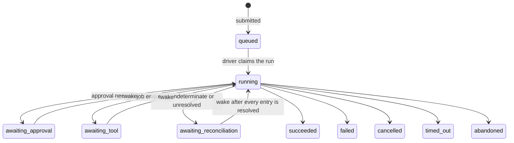
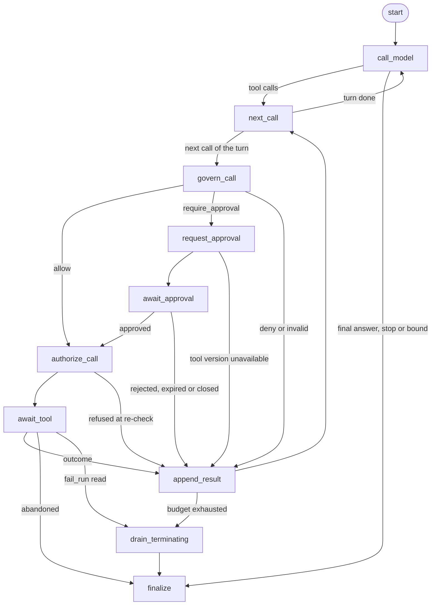

# Run lifecycle

This page follows a run from submission to a terminal status: its statuses and who may change
them, the model turn loop in the run graph, the bounds that end a run, stops, the reconciliation
hold, and replay. It is for engineers who need to predict what a run does in any situation.

A **run** is one agent task submitted by a requester. It is driven by a LangGraph graph whose
progress is checkpointed, but its status and every fact about the outside world live in Tether's
own tables ([Overview](overview.md#what-tether-owns-and-what-langgraph-owns)).

## Statuses

| Status | Meaning |
|---|---|
| `queued` | Submitted; no worker has driven it yet. |
| `running` | A run driver holds it and is executing graph nodes. |
| `awaiting_approval` | A proposed call needs a human decision. No process is waiting on it. |
| `awaiting_tool` | A tool job is queued or in flight for the current call. |
| `awaiting_reconciliation` | Held: a ledger entry is `indeterminate`, or the run must end but an entry is still unresolved. |
| `succeeded` | Terminal. The model gave a final answer. |
| `failed` | Terminal. A bound, a provider failure, an integrity failure or an exhausted job ended it. |
| `cancelled` | Terminal. A cancellation was requested and honoured. |
| `timed_out` | Terminal. The stored deadline passed and was honoured. |
| `abandoned` | Terminal. A reconciler resolved an unknown outcome as abandoned. |

Two transitions are not drawn. When an `advance_run` job exhausts its deliveries, its dead-letter
transition moves the run from whatever non-terminal status it has to `awaiting_reconciliation` if
a ledger entry is unresolved, otherwise to `failed`
([Execution and recovery](execution-and-recovery.md#dead-letter)). And a worker whose bootstrap
file no longer configures the run's workspace or agent moves it to `awaiting_reconciliation` or a
terminal status without invoking the graph ([below](#configuration-unavailable)).

A run moved to `awaiting_reconciliation` by a dead-letter is not failed. When its hold clears it
resumes normally. If whatever made the job fail persists, the job dead-letters again and, with
nothing unresolved, the run ends `failed` with `system_error`.

### Who writes the status

Only the run driver writes `runs.status` ([ADR-0006](../adr/0006-run-lifecycle-single-status-writer.md)).
The single exception is the `queued` insert at submission. Everything else (a cancel request, a
passed deadline, an approval decision, a reconciliation) writes a *request* or a row of its own and
enqueues an `advance_run` wake job; the driver reads the new state and changes the status.

Each driver invocation starts with a **claim**: under the run's advisory lock, one update
increments `driver_generation` (the fencing token) and sets the status to `running`, from any
non-terminal status. The claim is skipped while a run held in `awaiting_reconciliation` still has
unresolved ledger entries ([below](#the-reconciliation-hold)). Every later status change is
conditional on the expected status and on that token, so a stale driver cannot write ([Execution
and recovery](execution-and-recovery.md#run-driver-lock-and-fencing-token)). Terminal statuses
cannot change at all; a database trigger enforces this ([Data model](data-model.md#constraints-that-carry-meaning)).

Two consequences follow. A cancelled or timed-out run shows its new status only after the driver
next runs; until then, clients read `cancel_requested_at` or `deadline_exceeded_at` alongside the
status. And a wake that finds nothing new still claims the run, so a run waiting for an approval
can show `running` for a moment before it returns to `awaiting_approval`.

Non-terminal statuses (`running` and `awaiting_*`), and the claim, are not audited. Every terminal
status is recorded with a `RUN_FINISHED` audit event in the same transaction.

## The run graph

Each `advance_run` delivery runs the driver once. The driver reads the run's checkpoint and
chooses one of three modes: **start** (no checkpoint yet: the system prompt and the task input
become the first messages), **resume** (the graph is interrupted: resume it with a meaningless
wake value), or **recover** (a crash interrupted a step: continue from the last checkpoint). If the
graph has already finished, the delivery does nothing.

The diagram omits two families of edges. On a stop, `govern_call`, `request_approval`,
`authorize_call` and `append_result` route straight to `finalize`. On a replay divergence, any node
that adopts a persisted row routes to `record_divergence`, then `drain_divergence`, then
`finalize`. A wake does not re-enter at the top: it resumes the interrupted wait node.

Nodes are either **write nodes**, which create authoritative rows and never interrupt, or **wait
nodes**, which only read authoritative rows and interrupt while the awaited condition does not
hold ([ADR-0003](../adr/0003-authoritative-tables-checkpoint-progress-cache.md)). Every node that
writes share-locks the run row and checks the fencing token in the same transaction as its
writes, and writes its audit event in that transaction too. A node that creates a decision, an
approval or a ledger entry first checks the stop predicate. The two drain nodes only share-lock the
run row to read the stop predicate; they write nothing.

| Node | Kind | What it does |
|---|---|---|
| `call_model` | write | Checks the stop predicate and the turn bound, calls the model provider, records one `model_calls` row per attempt, and assigns each proposed tool call a step ordinal. |
| `next_call` | routing | Takes the next proposed call of the turn, or returns to `call_model` when none is left. |
| `govern_call` | write | Validates the call against the tool's input schema and evaluates policy. Records `POLICY_DECISION` (with the call hash and pinned tool version) or `CALL_INVALID`. |
| `request_approval` | write | Creates the approval bound to the decided call hash, records `APPROVAL_REQUESTED` and schedules an `expire_approval` timer. |
| `await_approval` | wait | Re-reads the approval; interrupts while it is `pending`. |
| `authorize_call` | write | Re-evaluates the call under current policy and re-checks the approval, then creates the ledger entry, records `EXECUTION_AUTHORIZED` and enqueues `execute_tool`. |
| `await_tool` | wait | Re-reads the ledger entry; interrupts with `awaiting_tool` while it is in flight, or `awaiting_reconciliation` while it is `indeterminate`. |
| `append_result` | write | Gives the model the call's typed result, applies the repair and denial bound, and records `CALL_SKIPPED` for the rest of the turn when the call did not apply. |
| `record_divergence`, `drain_divergence` | write, wait | Fail closed on a replay divergence ([below](#replay-and-replay-divergence)). |
| `drain_terminating` | wait | Holds a run that must end until every ledger entry is resolved. |
| `finalize` | write | Writes the terminal status, its `outcome_summary` and `RUN_FINISHED`. |

When a wait node interrupts, the driver records the matching waiting status and the job ends. No
process blocks while a run waits for a tool, an approval or a person. The transaction that changes
the awaited row (an outcome, an approval decision, an expiry, a reconciliation) enqueues its own
wake job. Resume values and job payloads carry no meaning: the woken wait node re-reads the
authoritative row and interrupts again if nothing changed.

Policy evaluation, approval and the ledger are explained in
[Policy](../governance/policy.md), [Approvals](../governance/approvals.md) and
[Side effects and the ledger](../governance/side-effects-and-ledger.md). This page covers only how
they move a run.

## The model turn loop

One **model turn** is one successful model response. If it contains tool calls, they are governed
one at a time, in the order the model returned them ([ADR-0012](../adr/0012-sequential-multi-call-governance.md)).
Each call has its own step ordinal and is validated, decided, approved and ledgered on its own.
There is no batch approval.

The rest of the turn waits, ungoverned, while the current call is pending approval, in flight or
`indeterminate`. When the current call reaches a final result:

- **`applied`** (by the tool, by verification or by a reconciler): governance moves to the next
  call.
- **Anything else** (`invalid`, `denied`, `rejected`, `expired`, `not_applied`, `failed`): every
  remaining call of the turn is **skipped**. Each skipped call gets one `CALL_SKIPPED` audit event
  carrying identifiers and the cause only (the trigger's ordinal, call ID and outcome, never
  arguments), and the model receives a `skipped` result whose content is
  `{"reason": "earlier_call_not_applied", "trigger_call_id": ..., "trigger_outcome": ...}`. A
  skipped call is never validated, decided, approved, ledgered or sent.

The model always receives exactly one result per call ID, in the original order. After the last
result, the graph calls the model again with the extended history. If the model proposes the same
action again, it is a new call: a new ordinal, a new idempotency key, a fresh policy decision and,
if required, a fresh approval.

A turn with no tool calls is a final answer: the run ends `succeeded`, and the model's text becomes
the `outcome_summary`.

### Bounds that end a run

| Bound | Setting (development default) | What counts | When exceeded |
|---|---|---|---|
| Model turns | `TETHER_MAX_MODEL_TURNS` (8) | Successful model turns | Checked before the next model call: the run ends `failed`, summary `model turn budget exhausted`. |
| Provider attempts | `TETHER_PROVIDER_MAX_ATTEMPTS` (3) | Attempts within one turn; only errors the adapter marks retryable are retried, with a jittered backoff (0.5 s base, doubling, 5 s cap) | A non-retryable error, or the last attempt failing, ends the run `failed` with summary `model call failed: ` followed by the provider error's text. |
| Repairs | `TETHER_MAX_REPAIRS` (3) | Invalid proposals: unknown or unoffered tool, invalid or unparseable arguments | One more than the bound ends the run `failed` with `repair_budget_exhausted`. |
| Denials | `TETHER_MAX_DENIALS` (3) | Policy denials: a `deny` decision on a proposal, or current policy denying the call at the re-check before execution | One more than the bound ends the run `failed` with `denial_budget_exhausted`. |
| Run deadline | `TETHER_RUN_MAX_DURATION_SECONDS` (3600) | Wall-clock time from submission, by the database clock | A stop: the run ends `timed_out` ([Stops](#stops)). |

Human rejections, expired approvals, skipped calls and tool failures count against no budget.
These values are development defaults, not tuned operating limits
([Configuration](../operations/configuration.md)).

Each model attempt gets its own `model_calls` row with the provider, model, attempt number, status,
token usage as the provider reported it, and a normalised error code. Two kinds of attempt are not
recorded: one interrupted by a crash before the provider answered, and one made by a driver that
has since been fenced (its row rolls back with the failed token check). No fallback to a second
provider exists.

### Terminating results

An exhausted repair or denial budget, a read tool declared with `on_exhausted="fail_run"` whose
outcome stayed unknown, an abandon by a reconciler, a replay divergence and an active stop are
**terminating**: the remaining calls of the turn are neither governed nor marked skipped, and no
further model call happens. An abandon ends the run `abandoned` and a stop ends it as described
under [Stops](#stops). For an exhausted repair or denial budget, a `fail_run` read and a replay
divergence, the run is first held in `awaiting_reconciliation` while any of its ledger entries is
unresolved. Then an active stop decides the status (`cancelled` or `timed_out`, with the reason
appended to the summary); otherwise the run ends `failed` with the reason. The model-turn budget
and a provider failure end the run directly, without the hold.

## Stops

A **stop** is a cancellation or a passed deadline. The **stop predicate** is true when a
cancellation has been requested, or when the database clock (`clock_timestamp()`) has reached the
run's stored `deadline_at`. The deadline is fixed at submission and never changes.

Stops are recorded, not executed:

- **Cancel.** The requester calls `POST /v1/tasks/runs/{run_id}/cancel`, or a workspace admin
  calls `POST /v1/ops/runs/{run_id}/cancel`. One transaction locks the run row, sets
  `cancel_requested_at` and `cancel_requested_by`, closes every pending approval of the run, writes
  `CANCEL_REQUESTED` and one `APPROVAL_CLOSED` per closed approval, and enqueues a wake. The API
  returns `202` with the recorded request.
- **Deadline.** The `run_deadline` timer job, due at `deadline_at`, does the same with
  `deadline_exceeded_at` and `DEADLINE_EXCEEDED`. Because the predicate compares the clock with the
  stored deadline, the deadline is enforced at every gate even if no worker has run the timer yet.
  But the timer is also what closes pending approvals and wakes the run: without it, a run waiting
  on an approval ends only when that approval's own expiry timer wakes it.

Both are no-ops on a terminal run or when their flag is already set. Neither writes the status.

**Which wins.** If a cancellation was requested at or before the deadline, the run ends
`cancelled`. If the deadline passed first, it ends `timed_out`, even if a cancellation arrives
later.

**Where the predicate is checked:**

- before every provider attempt, including retries;
- as soon as a model response returns: its token usage is recorded, and its proposals are
  discarded without being governed;
- at the start of each write node, before an approval or ledger entry exists (`govern_call`,
  `request_approval`, `authorize_call`), and before skip events are written;
- before the first send of a tool call and before every re-send
  ([Execution and recovery](execution-and-recovery.md#executing-a-tool-call));
- before every automatic verification probe ([Unknown outcomes](../governance/unknown-outcomes.md)).

**What a stop never does.** It never recalls or interrupts a write that has been dispatched. Once a
ledger entry exists for a call, the stop flag does not short-circuit the wait for its outcome.
The run shows `awaiting_tool` with the stop flag set until the outcome is recorded. A dispatched
write whose outcome is unknown becomes `indeterminate`, and the run shows `awaiting_reconciliation`
until verification or a reconciler resolves it. Reconciling a stopped run only records the outcome
and ends the run; it never leads to another model call.

**How a stopped run ends.** `cancelled` with summary `cancelled by <subject>`, or `timed_out` with
summary `deadline passed`, followed by every reconciled or verified outcome of the run, for example
`cancelled by alice; restart_service reconciled_applied`. A stopped run is therefore never reported
as clean when one of its writes needed resolution. A reconciler who chooses `abandon` ends the run
`abandoned` instead.

## The reconciliation hold

A run in `awaiting_reconciliation` stays held while any of its ledger entries is unresolved
(`pending`, `dispatched` or `indeterminate`)
([ADR-0018](../adr/0018-awaiting-reconciliation-hold.md)). A wake that finds it held does nothing:
the driver claims no fencing token, changes no status and calls neither the graph nor the model.

A run reaches the hold in four ways: the entry it waits on became `indeterminate`; it must end (a
terminating result or a replay divergence) while an entry is still unresolved; its `advance_run`
job was dead-lettered while an entry was unresolved; or its configuration is unavailable while an
entry is unresolved. It leaves the hold through the ordinary driver claim, once every entry is
resolved by its own recorded outcome, by its dead-letter transition, by automatic verification, or
by a reconciler. Each of those transactions enqueues its own wake.

The hold exists so that a terminal status never hides a real-world effect whose outcome is still
unknown, and so that a repeatedly failing driver cannot loop.

## Replay and replay divergence

LangGraph re-runs an interrupted node from its start on resume, and re-runs from the last
checkpoint after a crash. Replay is therefore normal, and every write node is built for it:

- **Create-or-get by a deterministic key.** The decision event is keyed `decision:<ordinal>`;
  approvals and ledger entries by run and step ordinal; skip events by `skipped:<ordinal>`; the
  terminal event by `run_finished`. A replayed node finds the existing row instead of writing a
  second one.
- **Decisions are adopted, not re-decided.** A persisted policy decision is reused on replay. This
  is safe because policy is re-evaluated against current policy before any side effect.
- **Ledger first.** Once a ledger entry exists for a call, it is authoritative: the graph follows
  its state.
- **Every adoption is hash-checked.** Before adopting a persisted decision, approval or ledger row,
  the node recomputes the call hash of the call it is replaying, under the run's binding key and the
  row's pinned tool version, and compares it with the stored hash.

A mismatch is a **replay divergence**: the checkpoint lineage and the persisted record disagree
about which call this ordinal is. Tether fails closed:

1. It writes one `REPLAY_DIVERGENCE` audit event with the two hashes and the path where the
   mismatch was found. It writes nothing else: no decision, approval or ledger row is created,
   changed or removed.
2. From then on, the recorded event blocks every further model call, every send and every
   verification probe for the run. A `pending` entry is refused before dispatch; a dispatched one
   is never re-sent. No further authorization happens because the diverged run is routed to
   `drain_divergence` and `finalize`, not through `authorize_call`.
3. The run is held while any ledger entry is unresolved.
4. It then ends. An active stop still decides the status (`cancelled` or `timed_out` with
   `replay_divergence` in the summary); otherwise it ends `failed` with summary `replay_divergence`.

A divergence ends the run; Tether never repairs or rewrites the record to make hashes match.

One case looks like a divergence and is not. If a call's pinned tool version is no longer
registered when the graph replays it and **no ledger entry exists yet**, the call gets a typed
`not_applied` result (`tool version unavailable`) and nothing is sent. If a ledger entry already
exists, the ledger is authoritative and the run follows the entry's recorded outcome.

### Configuration unavailable

If a worker's bootstrap file no longer configures the run's workspace or agent, the driver does not
invoke the graph: nothing is decided, authorized or sent. While any ledger entry is unresolved,
the run is held in `awaiting_reconciliation`, so a configuration change never hides an in-flight
or unknown effect. Once every entry is resolved, an active stop decides the status; otherwise the
run ends `failed` with summary `configuration_unavailable`, followed by any reconciled outcome.

## How a run ends

| Status | `outcome_summary` |
|---|---|
| `succeeded` | The model's final text. |
| `failed` | `model turn budget exhausted`; `model call failed: ...`; `repair_budget_exhausted`; `denial_budget_exhausted`; `tool_exhausted:<tool>`; `replay_divergence`; `configuration_unavailable`; `system_error` (an exhausted `advance_run` job). After `repair_budget_exhausted`, `denial_budget_exhausted`, `tool_exhausted:<tool>` and `configuration_unavailable`, every reconciled or verified outcome of the run is appended. `model turn budget exhausted`, `model call failed: ...`, `replay_divergence` and `system_error` are recorded as written. |
| `cancelled` | `cancelled by <subject>`, plus any terminating reason and every reconciled or verified outcome. |
| `timed_out` | `deadline passed`, plus the same. |
| `abandoned` | `<tool> abandoned by reconciliation`. |

`GET /v1/tasks/runs/{run_id}` returns the status, the summary, the stop fields, the run's approvals,
its ledger entries, its audit timeline and whether the audit chain verifies, from authoritative rows
only ([API reference](../reference/api.md)).

## Related

- [Execution and recovery](execution-and-recovery.md): how the driver is serialised and what
  happens on a crash.
- [Data model](data-model.md): the transactions behind each node.
- [Unknown outcomes](../governance/unknown-outcomes.md): verification and reconciliation.
- [Guarantees](../guarantees.md): what is proven about stops and terminal statuses.
- [Design history](tether-v1-architecture.md): the original design record.
