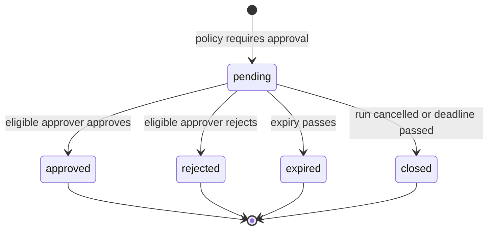
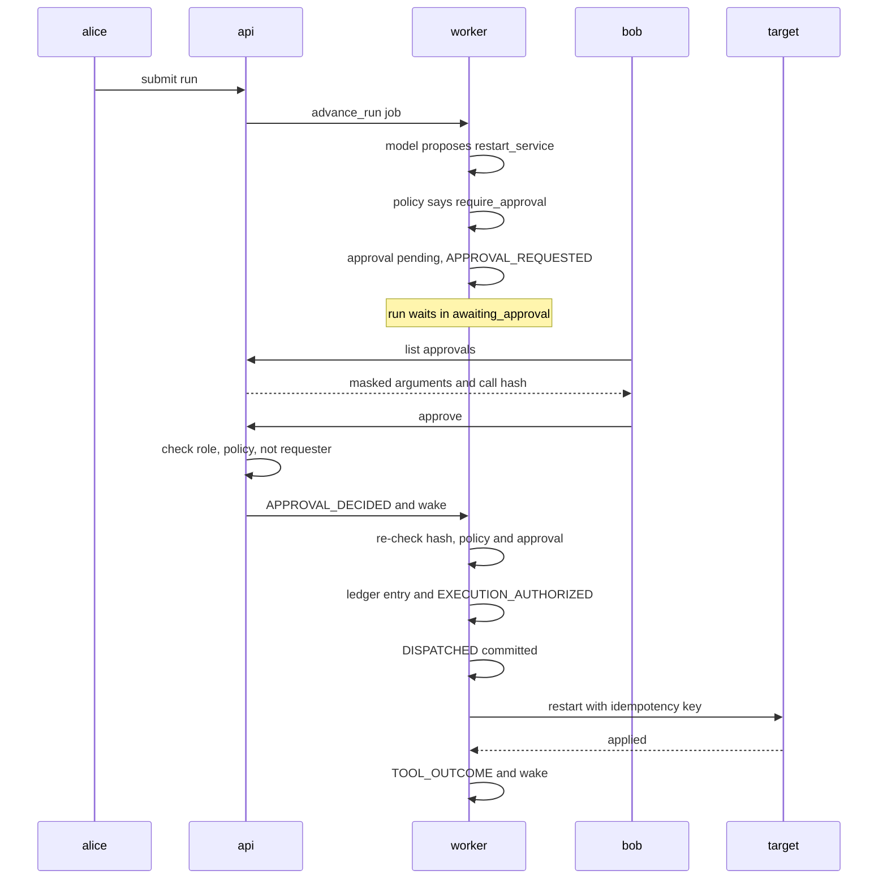

# Approvals

How a person approves one exact tool call before it runs, and why an approval can never be stretched
to cover a different call. This page is for engineers integrating an approval step and for reviewers
checking the binding. The endpoints are documented in the [API reference](../reference/api.md); who
may hold which role is in [Authentication and authorization](../security/authentication-and-authorization.md).

An approval is created when [policy](policy.md) answers `require_approval` for a proposed call. The
run pauses in `awaiting_approval` until an eligible approver decides, the approval expires, or the
run is stopped.

## What an approval binds

An approval is not "permission to restart services". It is permission for one call: this tool, at
this version, with these arguments, in this run, for this agent, in this workspace. Tether enforces
that with a **call hash**.

The call hash is an HMAC-SHA-256, computed under a secret binding key, over the RFC 8785 canonical
JSON of a fixed envelope ([ADR-0010](../adr/0010-keyed-canonical-call-hash.md)). The envelope is
built in `src/tether/core/hashing.py`:

| Field | Value |
|---|---|
| `v` | Envelope version, `1` |
| `workspace_id`, `run_id`, `agent_id` | The run's identity |
| `tool`, `tool_version` | The tool and its pinned version |
| `arguments` | The validated arguments, unmasked, in JSON form |
| `preconditions` | Each declared precondition field and its value (empty if the tool declares none) |

The model's call ID and its stated rationale are deliberately not in the envelope: they do not change
what would happen. Change anything that does, even one character of one argument, and the hash
changes.

Three design choices make the binding hold:

- **Canonical JSON.** RFC 8785 gives one byte sequence for one value, whatever library or key order
  produced it. A write tool's envelope refuses binary floating-point numbers, whose text form is not
  stable.
- **Validated arguments.** The hash covers the arguments after they pass the tool's input model,
  which are the arguments that will execute, not the model's raw text.
- **A keyed hash.** With a plain SHA-256, anyone who can read the hash could recover a low-entropy
  sensitive argument by guessing. The binding key lives outside the database, in the
  `TETHER_BINDING_KEY_<ID>` family, separate from the audit keys. Each run is pinned to the key that
  was active when it started, so rotating the key never changes an existing hash. See
  [Secrets and data handling](../security/secrets-and-data-handling.md).

The same hash is recorded at every step and compared, in constant time, at every step: in the policy
decision, on the approval, on the ledger entry, and by the worker against the arguments it is about
to send. If any two disagree, nothing runs.

### Tool version pinning

The version is fixed when the call is proposed: governance resolves the version currently offered
under the tool's name, and that version enters the envelope, the decision, the approval and the
ledger ([ADR-0011](../adr/0011-tool-version-pinning-approval-validity.md)). Exactly that version
executes, or nothing does. A deployment that ships a new version while an approval is waiting does
not change what the approver approved. If the pinned version is no longer registered when the call is
authorized, the call is refused as `not_applied` and the model may propose again. A workload that
wants waiting calls to survive a deployment keeps the old version registered as a retained version
(see [Writing a tool](../development/writing-a-tool.md)).

### Preconditions

A write tool can declare preconditions: required input fields whose values the target checks
atomically with the write. The incident-remediation tool `update_service_config` declares
`expected_config_version`. The approver therefore approves "set this key, but only if the
configuration is still at version 7". If the configuration has moved on by the time the write runs,
the target refuses it, the tool raises `ToolNotApplied`, and the call is `not_applied` with the
target unchanged. Preconditions are part of the envelope and are shown, masked, in the approval.

## Lifecycle

| Status | Written by | What the run does next |
|---|---|---|
| `pending` | The run driver, with `APPROVAL_REQUESTED`, in the same transaction as an expiry timer job | Waits in `awaiting_approval` |
| `approved` | The approval route, with `APPROVAL_DECIDED` and a wake | Re-checks and, if still valid, authorizes the call |
| `rejected` | The approval route, with `APPROVAL_DECIDED` and a wake | The model gets a typed `rejected` result |
| `expired` | The expiry timer, with `APPROVAL_EXPIRED` and a wake | The model gets a typed `expired` result |
| `closed` | A cancellation or an exceeded deadline, with `APPROVAL_CLOSED` | The run ends because of the stop |

Every status after `pending` is final. One approval exists per call, so a re-proposal after a
rejection is a new call with a new approval.

## Who may decide

All of these must hold, checked in this order; any failure returns `404`, so a caller cannot tell an
approval they may not see from one that does not exist
([ADR-0013](../adr/0013-identity-trust-boundary-workspace-isolation.md)):

1. A valid token for the `tether-approvals` audience, for the approval's workspace.
2. The core `approver` role in that token.
3. Policy eligibility under the active policy version: a role named in the tool's `approver_roles`.
4. The approver is not the run's requester. This holds whatever roles the requester has.

Roles come from the validated token only; roles supplied in a request body are ignored. A stale
policy in the API process returns `503` with nothing changed.

The decision itself is refused with `409` if the approval is no longer `pending`, has expired by
database time, or its run is stopped or terminal. Two approvers racing get one `200` and one `409`.
An optional `reason`, up to 500 characters, is recorded in the `APPROVAL_DECIDED` event together with
the approver's subject and the policy version.

## Expiry

Every approval expires. Its `expires_at` is set when it is requested, from:

- the tool rule's `approval_expiry_seconds`, if the rule sets one; otherwise
- `TETHER_APPROVAL_TTL_SECONDS` (default 3600 seconds).

Neither may exceed `TETHER_APPROVAL_MAX_TTL_SECONDS` (default 86400 seconds). A larger value is
refused by `tether bootstrap apply` and at worker startup, never clamped. These defaults are
configurable and are proposed values, not yet confirmed as product defaults; see
[Configuration](../operations/configuration.md).

Expiry is enforced by database time wherever a decision is made, not by the timer. A decision
arriving after `expires_at` is refused even if the timer job has not run yet; the timer only records
the transition and wakes the run. An approval is also usable only before its expiry: an approval that
was granted but lapsed before the call was authorized (for example, after a long worker outage) gives
a typed `expired` result, and the model must propose again for a fresh approval.

## What the approver sees

The approval list returns pending approvals the caller could decide right now, oldest first. It is
advisory: an approval in the list may be decided by someone else, expire or close before the caller
acts, and the decision route re-checks everything. Approval detail and the approver's run evidence
view return:

- the tool, its pinned version and the call hash;
- the arguments and precondition values, **masked**: any field the tool marks `Sensitive` is
  replaced before the approval is stored, so the approver never sees its value;
- the requester's subject, the agent, the creation and expiry times, and whether the approval is
  still actionable;
- for a decided approval, who decided, when, why, and under which policy version.

The model's rationale is not shown, and neither is the tool's risk level. The run evidence view adds
the run's ledger entries and audit event types, with whether the audit chain verifies. Approvers see
only approvals and runs they are eligible for. A permitted run view writes an access event; see
[Audit](audit.md).

## The re-check before execution

An approval is necessary but not sufficient. When the run resumes after `approved`, the run driver
re-checks the call in the transaction that would create its ledger entry, under the current policy:

| Check | If it fails |
|---|---|
| The call's hash, recomputed now, equals the hash that was decided | Refused as `denied` ("call changed since its decision") |
| Current policy does not deny the call | Refused as `denied` ("policy now: deny") |
| An approval for this call exists, is `approved` and carries the same hash | Refused as `denied` ("no matching approval") |
| That approval has not expired | Refused as `expired` ("approval lapsed") |

A `deny` from current policy overrides an approval: a permission revoked after the approval was given
stops the call. A refused call gets no ledger entry and nothing is sent. Once the ledger entry exists,
the approval is not checked again; only a stop prevents the dispatch.

This re-check is implemented and covered by tests, but it is not yet part of the proven approval
guarantee, and a refusal here writes no audit event of its own: the model's typed result and the
absence of `EXECUTION_AUTHORIZED` are the only record. See [Guarantees](../guarantees.md).

## Cancellation and deadlines

A cancellation or an exceeded deadline closes every pending approval of the run in the same
transaction that records the stop, with an `APPROVAL_CLOSED` event for each. A later attempt to
approve gets `409`. An approval that was already `approved` is not closed, but the stop is checked
again before authorization and before dispatch, so the call does not run. See
[Run lifecycle](../architecture/run-lifecycle.md).

## Worked example

The requester `alice` (role `operator`) asks the incident agent to fix a failing service. The model
reads the service's health, then proposes `restart_service` for `checkout`. The approver `bob` holds
`approver`.

The audit chain for this run records, in order: `RUN_SUBMITTED`, `POLICY_DECISION`,
`EXECUTION_AUTHORIZED`, `DISPATCHED`, `TOOL_OUTCOME` for the read, then `POLICY_DECISION`,
`APPROVAL_REQUESTED`, `APPROVAL_DECIDED`, `EXECUTION_AUTHORIZED`, `DISPATCHED`, `TOOL_OUTCOME` for
the restart, and `RUN_FINISHED`. The `call_hash` in the restart's `POLICY_DECISION` event, on the
approval and on the ledger entry is the same value. If `alice` had tried to approve her own request,
the approval route would have returned `404`.

## Limits

- The approval detail does not show the model's rationale or the tool's risk level.
- An approver who acted on an approval and later loses eligibility loses access to that run's
  evidence view.
- There is no approval user interface; approvers use the HTTP API.
- A refusal at the re-check before execution writes no audit event of its own.

## Related

- [Policy](policy.md)
- [Side effects and the execution ledger](side-effects-and-ledger.md)
- [API reference](../reference/api.md)
- [Authentication and authorization](../security/authentication-and-authorization.md)
- [Guarantees](../guarantees.md)
