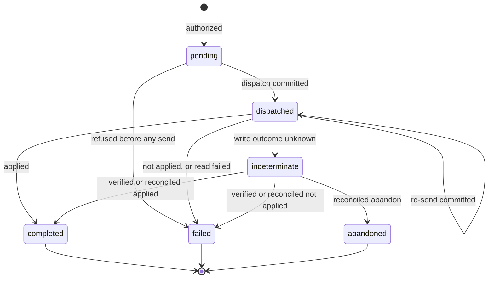

# Side effects and the execution ledger

How Tether makes a tool's side effect safe to attempt: what is recorded before and after the external
call, when a call is sent again and when it never is, and how each result is classified. This page is
for engineers writing tools and for reviewers checking the at-most-once and idempotency claims. What
happens when an outcome cannot be known is in [Unknown outcomes](unknown-outcomes.md).

## The execution ledger

The **execution ledger** is the table `tether.ledger_entries`. It holds one **ledger entry** per
governed call that was authorized to run, reads included. An entry is unique per run and step
ordinal, so a replay or a second worker can never create a second entry for the same call. It
records the tool and its pinned version, the effect (`read` or `write`), whether the call may be
re-sent (`idempotent` or `non_idempotent`), the call hash, the idempotency key, the number of sends,
the state, and the masked outcome.

Only the run driver creates an entry, and only after the call passed policy and, if required,
approval. The only code that ever calls a tool is the `execute_tool` job handler in
`src/tether/worker/handlers/execute_tool.py`. LangGraph graph nodes never perform side effects.

## Three commits around every send

Every tool call goes through three committed transactions, in this order. Each writes its state
change, its audit event and any follow-up job together, or nothing.

| Order | Transaction | Writes | Commits before |
|---|---|---|---|
| 1 | Authorization | Ledger entry in `pending`, `EXECUTION_AUTHORIZED`, an `execute_tool` job carrying the validated arguments | The job can run |
| 2 | Dispatch | Entry `pending → dispatched`, send count + 1, `DISPATCHED` (or `REDISPATCHED` for a re-send) | Any byte leaves Tether |
| 3 | Outcome | Entry to its outcome state with its outcome class, masked output, `TOOL_OUTCOME`, and a job that wakes the run | The run continues |

The order is what makes every crash explainable afterwards:

- **Crash before dispatch commits.** The entry is `pending`. Nothing was sent, so Tether can say
  with certainty that the call did not apply.
- **Crash after dispatch commits, before the outcome.** The entry is `dispatched`. The send may or
  may not have reached the target. Tether does not guess: what happens next depends on whether the
  call may be re-sent (below).
- **Crash after the outcome commits.** The outcome is recorded and the run is woken.

Before sending, the worker recomputes the call hash from the job's arguments and compares it with the
entry's. A mismatch is never sent: a `pending` entry becomes `failed` (`not_applied`), and a
`dispatched` entry, which may already have applied, becomes unknown. The worker also resolves exactly
the entry's pinned tool version; if this worker cannot, the same two rules apply
([ADR-0011](../adr/0011-tool-version-pinning-approval-validity.md)).

The outcome commit is conditional on the entry still being `dispatched`, so the first outcome
recorded wins and a late duplicate cannot overwrite it. Transactions, lock order and the queue are
described in [Data model](../architecture/data-model.md) and
[Execution and recovery](../architecture/execution-and-recovery.md).

## Entry states



`completed`, `failed`, `indeterminate` and `abandoned` are terminal for the send path: no outcome
write changes them. Only verification or a person moves an `indeterminate` entry on, and the
`resolution` column records which: `verified_applied` or `verified_not_applied` for a read-back,
`reconciled_applied`, `reconciled_not_applied` or `reconciled_abandon` for a person. An entry that
reached its state through its own outcome has no resolution. A read never becomes `indeterminate`.

A `pending` entry is refused before any send when the run has been stopped, when a replay divergence
was recorded for the run, when the arguments' hash does not match, when the pinned version cannot be
resolved, or when the job's deliveries run out before dispatch.

## Outcome classes

Every outcome write records an **outcome class** alongside the state:

| Class | Meaning | Evidence required |
|---|---|---|
| `applied` | The effect happened | The tool returned normally |
| `not_applied` | The effect did not happen | Positive evidence only: the tool raised `ToolNotApplied`, or Tether refused before any send |
| `unknown` | Tether cannot tell | None: everything after a dispatch that is neither of the above |
| `failed` | A read returned output that violates its schema | Nothing can have changed at the target |

**Only positive evidence is `not_applied`.** A timeout, a dropped connection, a `5xx`, a crash, an
unexpected status, an exception of any kind after dispatch: each is `unknown`, never `not_applied`
and never "failed" in the sense of "did not happen". A tool raises `ToolNotApplied` only when the
target has told it, with certainty, that nothing was applied, for example a `404` for an unknown
service or a `409` from an atomic precondition check. Tether trusts that declaration.

The model sees `applied` with the masked output, `not_applied` with the reason, or a typed `failed`
result for a read that failed. It never sees a write whose outcome is unknown reported as failed: the
run waits instead. A write that reported success but returned output violating its schema is still
`applied`, because the effect happened; its output is never stored or shown, and the model sees only
an `output_invalid` marker.

Any result other than `applied` ends the model turn: later calls the model proposed in the same turn
are skipped, each with a `CALL_SKIPPED` event
([ADR-0012](../adr/0012-sequential-multi-call-governance.md)).

## Idempotency keys

Every entry has a deterministic **idempotency key**, computed once when the entry is created and
stored on it ([ADR-0008](../adr/0008-idempotency-keys-and-stop-gated-resends.md)):

```text
tth_ + base32( SHA-256( RFC 8785 JSON of [run_id, step_ordinal, call_hash] ) ), lowercase, unpadded
```

The key identifies one logical execution: this call, at this position, in this run. Every send of
that execution, first or retry or redelivery, carries the same key in `ToolContext.idempotency_key`.
A tool forwards it to the target (the incident-remediation tools send it as an `Idempotency-Key`
header). A re-proposal of the same action later in the run is a new step ordinal, so it gets a new
key, a new decision and, if required, a new approval. Because the key is derived from the keyed call
hash, it reveals nothing about the arguments.

## What is re-sent, and what never is

An unknown outcome is sent again only when that cannot duplicate an effect:

| Condition | Required for a re-send |
|---|---|
| The entry is a read, or a write declared `idempotency="supported"` | Yes |
| Sends so far are below the tool's `max_attempts` (default 3) | Yes |
| No stop (cancellation or exceeded deadline) is active | Yes |
| No replay divergence is recorded for the run | Yes |
| The failure was not a schema-invalid output | Yes |

A retry waits for a backoff delay first: uniform between zero and a ceiling of 0.5 seconds doubling
per send, capped at 5 seconds. The job is released with that delay and picked up again. Before the
re-send, a committed `REDISPATCHED` record re-checks the stop, the budget and the replay divergence;
the send happens only after that record commits.

The send budget, `max_attempts`, is **shared by retries and redeliveries**. If a worker dies with a
send in flight and the job is redelivered, that redelivery counts against the same budget. When the
budget is spent and the outcome is still unknown, the outcome is final: a write becomes
`indeterminate`, a read a typed failure.

**Never re-sent:**

- **A non-idempotent write.** Once dispatched, it is sent at most once. Any unknown outcome, a
  redelivery after a crash, or a second worker taking the job after a lease expired, makes it
  `indeterminate` without another send.
- **Anything after a stop.** A cancellation or exceeded deadline never interrupts a send already in
  flight, but no new send or re-send starts afterwards. An unknown outcome then becomes `indeterminate`
  for a write.
- **A schema-invalid output.** It is a definite answer, not an unknown one.

Each send is bounded by the tool's `timeout_seconds` (default 10, at most 300). A timeout is always
`unknown`. A send is never shortened to fit the run's deadline.

Re-sending an idempotent write relies on the target honouring the key. Two sends with the same key
can be in flight together, for example when a lease expires during a slow send; applying once is then
the target's deduplication.

## Tool kind by outcome

| Tool | Returns normally | Raises `ToolNotApplied` | Unknown, budget left, no stop | Unknown, otherwise |
|---|---|---|---|---|
| Read | `completed`, `applied` | `failed`, `not_applied` | Re-sent with the same key | `failed`, `unknown`: typed failure, or the run ends if `on_exhausted="fail_run"` |
| Idempotent write | `completed`, `applied` | `failed`, `not_applied` | Re-sent with the same key | `indeterminate`: verification, then a person |
| Non-idempotent write | `completed`, `applied` | `failed`, `not_applied` | Never re-sent | `indeterminate`: verification, then a person |

## Reads that must succeed

By default, a read whose outcome stays unknown after its budget gives the model a typed failure, and
the model decides what to do. A read declared `on_exhausted="fail_run"` instead ends the run `failed`
with the reason `tool_exhausted:<tool>`, with no further model call. If another ledger entry of the
run is still unresolved, the run is held until it is resolved; an active stop still decides between
`cancelled` and `timed_out`. Only reads may declare `fail_run`, and it triggers only on an unknown
outcome, not on `ToolNotApplied`.

## What a tool author controls

A tool's descriptor decides how Tether treats its side effects. The author declares:

- `effect`: `read` or `write`.
- `idempotency` (required for writes): `supported` only if the target deduplicates by the forwarded
  key; otherwise `unsupported`.
- `max_attempts` and `timeout_seconds`: the send budget and the bound on one send.
- `on_exhausted` (reads only).
- `preconditions` (writes only): fields the target checks atomically with the write.
- `verify` (writes only): a safe read-back for unknown outcomes.
- When to raise `ToolNotApplied`: only on a definitive rejection.
- Which fields are `Sensitive`.

A wrong declaration weakens the guarantees: a write declared `supported` against a target that ignores
the key can be applied twice. See [Writing a tool](../development/writing-a-tool.md).

## Limits

- Exactly-once is not claimed for arbitrary APIs. At-most-once holds for non-idempotent writes;
  idempotent re-sends rely on the target.
- Tether trusts a tool's `idempotency` and `ToolNotApplied` declarations.
- A handler that blocks the event loop starves the lease heartbeat; its job can be taken by another
  worker. See [Execution and recovery](../architecture/execution-and-recovery.md).

## Related

- [Unknown outcomes](unknown-outcomes.md)
- [Approvals](approvals.md)
- [Writing a tool](../development/writing-a-tool.md)
- [Execution and recovery](../architecture/execution-and-recovery.md)
- [Guarantees](../guarantees.md)
