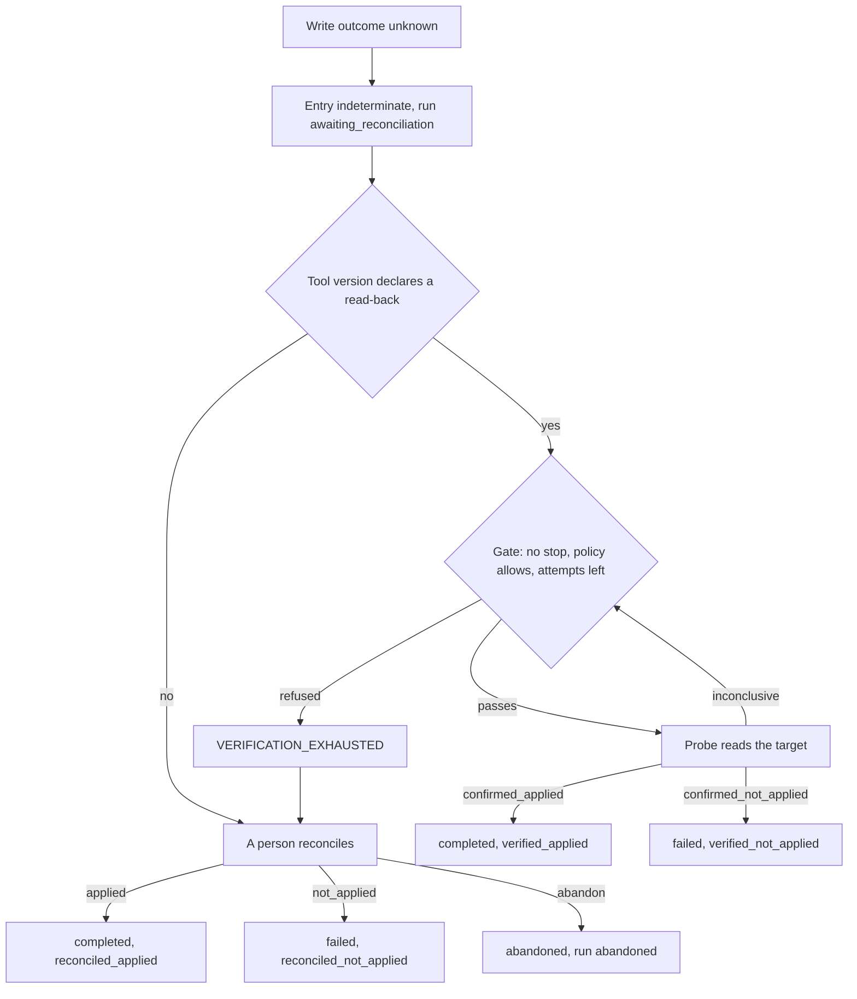

# Unknown outcomes

What Tether does when it cannot know whether a write was applied: how the entry is marked, how a
tool's read-back may settle it, and how a person settles it otherwise. This page is for engineers
writing tools with read-backs, for operators who reconcile, and for reviewers checking that Tether
never reports something it does not know. The step-by-step operator procedure is in
[Runbooks](../operations/runbooks.md).

**Tether itself never guesses;** it relies on the tool's `ToolNotApplied` and read-back being
truthful (see [Limits](#limits)). It does not assume a write failed because the connection dropped, and it
does not assume it succeeded because nothing complained. Without positive evidence, the outcome
stays unknown until a definitive read-back or a person resolves it.

## Why "unknown" is its own outcome

A write was dispatched and then the connection timed out. The target may have applied it and failed
to answer, or never received it. Reporting either as fact is dangerous:

- Reporting **failure** invites the model to try again. If the first attempt applied, that is a
  duplicate restart, a second payment, a second issue.
- Reporting **success** lets the run build on an effect that may not exist.

So Tether gives the write its own ledger state, `indeterminate`
([ADR-0019](../adr/0019-automatic-verification-of-unknown-outcomes.md)). It is not a failure. The
model is never told the write failed, and the run makes no further model call until the entry is
resolved. Outcome classes and the send rules that lead here are in
[Side effects and the execution ledger](side-effects-and-ledger.md).

## How an entry becomes `indeterminate`

A dispatched write becomes `indeterminate` when its outcome is unknown and it may not be sent again:

- the send timed out or raised, and the write is non-idempotent, or its send budget is spent, or a
  stop is active;
- the job was redelivered after a crash or a lost lease, and re-sending is not allowed;
- the job ran out of deliveries while the entry was `dispatched`;
- a re-send was needed but the pinned tool version or the governed arguments are no longer available.

The transaction that records `indeterminate` also records `TOOL_OUTCOME` and wakes the run. If the
pinned tool version declares a read-back, the same transaction enqueues a `verify_outcome` job. The
run moves to `awaiting_reconciliation` and stays there while any of its ledger entries is unresolved
([ADR-0018](../adr/0018-awaiting-reconciliation-hold.md)). Reads never become `indeterminate`.

## Resolution flow

## Automatic verification

The behaviour in this section is implemented and tested, but it is not yet part of the proven
guarantees; see [Guarantees](../guarantees.md).

### The read-back

A write tool may declare a `verify` read-back in its descriptor (a `VerifyDeclaration`). The
read-back is a separate function, the **probe**, that asks the target a question it can answer
definitively, such as "is there a restart recorded under this idempotency key?". It receives exactly
two things: the original call's validated arguments, and a `VerifyContext` holding the entry's
idempotency key. It returns one of three answers, each with evidence:

| Probe answer | Resolution | Entry becomes | The model sees |
|---|---|---|---|
| `confirmed_applied` | `verified_applied` | `completed` | `applied`, with the masked evidence and a `verified` marker |
| `confirmed_not_applied` | `verified_not_applied` | `failed` | `not_applied`, with the masked evidence and a `verified` marker |
| `inconclusive` | none | stays `indeterminate` | nothing yet |

A probe must only read. It must never repeat the write or change the target; Tether never calls the
tool's handler during verification, and the probe never consumes the write's send budget. That a
probe only reads is the tool author's contract: Tether cannot prove it for arbitrary code, and it is
tested only against the two reference targets.

Anything that is not a well-formed definitive answer is `inconclusive`: an exception (only its type
is kept), a probe that runs past the tool's `timeout_seconds`, a return value that is not a
`VerificationResult`, or evidence that does not validate against the declared `evidence_model`.
Evidence passes through the masking choke point before it is stored, audited or shown.

After a `verified_applied` resolution, the write's own output is still unknown and is not invented:
the model gets the evidence instead. After `verified_not_applied`, a new proposal of the same action is
a new call, with a new idempotency key, a new policy decision and, if required, a new approval.

### The gate before every probe

Each probe is preceded by a committed gate transaction. The gate requires, in this order:

| Check | Refusal reason |
|---|---|
| The entry is still `indeterminate`, unresolved, and verification has not already ended | (nothing to do) |
| No stop is active | `stopped` |
| No replay divergence is recorded for the run | `replay_divergence` |
| This worker has the run's workspace and agent configured | `configuration_unavailable` |
| The entry's pinned tool version resolves | `tool_version_unavailable` |
| That version declares a read-back | `not_declared` |
| Probes so far are below the declaration's `max_attempts` | `attempts_exhausted` |
| The stored arguments validate against the pinned input model | `arguments_invalid` |
| This process's policy is the workspace's active version | `policy_stale` |
| `evaluate_verification` answers `allow` | `policy_denied` |

When every check passes, the gate counts the attempt and records `VERIFICATION_ATTEMPTED`, and only
after that commits does the probe run. A refusal ends automatic verification for that entry: it
records `VERIFICATION_EXHAUSTED` with the reason (and `VERIFICATION_SKIPPED` as well when a stop is
the reason), wakes the run, and leaves the entry for a person.

### Policy authorization of the probe

The probe is authorized as its own read-purpose action, not as part of the write's approval
([ADR-0022](../adr/0022-verify-operation-policy-mapping.md)). The write's approval is never reused
as authority. `evaluate_verification` answers only `allow` or `deny`, and allows a probe only when:

- the tool is a write whose pinned version declares the read-back, and the evaluated version is the
  pinned one;
- the arguments the probe would receive hash to the entry's call hash, so a probe can only ask about
  the exact original call;
- the active policy version is the one that authorized the write. Requester and agent never change
  during a run, so under the same policy version the probe draws on the same requester and agent
  permissions that were in force when the write was authorized. **Any policy deployment
  between the write and its probe refuses the probe** (`policy_changed`), even if the new policy would
  allow it;
- the tool's rule is not `deny`, and a rule exists;
- the requester's role permissions intersected with the agent's cover the read-back's own
  `required_permissions`.

No second human approval is required ([ADR-0022](../adr/0022-verify-operation-policy-mapping.md)):
the probe is authorized as a separate read-purpose action for the same requester and agent, on the
same arguments, under the policy version that authorized the write, and needs its own declared
permissions, which both must hold. Those permissions need not be a subset of the write's: in the
reference workloads the read-backs need `service:read` and `issue:read`, while the writes need
`service:restart` and `issue:create`. That the probe only reads is the tool author's contract, not
something Tether proves. A policy refusal is not a model action and does not count toward the denial
budget. The evaluator's reasons, such as `policy_changed` or `target_mismatch`, are recorded in the
`VERIFICATION_EXHAUSTED` event. See [Policy](policy.md).

### Bounds

- **Probes per entry:** the declaration's `max_attempts` (default 3), and never more than the
  `verify_outcome` job's delivery bound (5), since every probe and every redelivery after a crash
  spends one delivery.
- **Delay between probes:** the declaration's `backoff`, by default uniform between zero and a
  ceiling of 1 second doubling per probe, capped at 30 seconds.
- **One probe:** bounded by the tool's `timeout_seconds`.
- **Job deliveries:** a `verify_outcome` job that runs out of deliveries ends verification with
  `delivery_exhausted`.

A crash after the gate commits but before the probe answers leaves the attempt counted; the job is
redelivered and the gate checks everything again.

### Stops during verification

If a stop is active, no probe starts. A probe already running when a stop commits is not interrupted:
it performs no new action on the world, and a definitive answer is still recorded. An inconclusive
answer under a stop ends verification and leaves the entry for a person. Once the entry is resolved,
by the probe or by a person, the run ends `cancelled` or `timed_out` and its summary names the
resolution. Verification never lets a stopped run continue.

## Human reconciliation

**Reconciliation** is a person resolving an `indeterminate` entry. It is required whenever the tool
declares no read-back, or verification ended without a definitive answer. A person may also reconcile
while verification is still in progress.

### Who may reconcile

A missing, invalid or wrong-audience token is `401`. With a valid `tether-ops` token, all of the
following must hold, and any failure returns `404`:

1. The entry is in the token's workspace.
2. The core `reconciler` role in that token.
3. Policy eligibility under the active policy version: a role listed in `reconciliation.reconciler_roles`.
4. The reconciler is not the run's requester.

A stale policy in the API process returns `503`, checked before eligibility. The route is `POST /v1/ops/ledger/{ledger_id}/reconcile`;
see the [API reference](../reference/api.md).

### The three outcomes

The reconciler states what happened, with a justification of 1 to 2000 characters. The
justification is recorded in the `RECONCILED` audit event and on the entry with the reconciler's
subject.

| Outcome | Entry becomes | Resolution | What the run does next |
|---|---|---|---|
| `applied` | `completed` | `reconciled_applied` | The model sees `applied`; the write is never run again, and its real output stays unknown |
| `not_applied` | `failed` | `reconciled_not_applied` | The model sees `not_applied`; the rest of that model turn is skipped; a re-proposal is a new call with a new key |
| `abandon` | `abandoned` | `reconciled_abandon` | The run ends `abandoned`, with no further model call |

Reconciliation records the outcome, the audit event and the wake in one transaction. It never calls
the tool. Only repeating the same human outcome is a no-op returning `200`. A different outcome on an
entry a person already resolved is `409`. Once verification has resolved an entry, any reconcile
request for it is `409`, whatever outcome it states. Reconciling an entry of a terminal run, or one
that is not `indeterminate`, is also `409`.

If the run was stopped, an `applied` or `not_applied` reconciliation records the outcome and the run
then ends `cancelled` or `timed_out`, with the reconciled outcome named in its summary. An `abandon`
ends the run `abandoned`.

### Whoever commits first wins; a late probe never overrides a person

A person and a probe can race. Both resolve the entry with a conditional update that succeeds only
while the entry is still `indeterminate` and unresolved, so exactly one wins. A probe never overrides
a person's decision. A probe that commits first stands.

- If the person commits first, a later probe answer is recorded as `VERIFICATION_LATE` evidence and
  changes nothing. Auditors can see both.
- If the probe commits first, the person's request gets `409` whatever outcome it states. The
  `verified_*` resolution stands, with its evidence, and there is no API to correct it.

The `resolution` value always shows which of the two settled the entry, and `resolved_by` is either
the reconciler's subject or `system:verification`.

## While a run waits

The run stays in `awaiting_reconciliation` while any ledger entry is `pending`, `dispatched` or
`indeterminate`, and it holds no compute: a wake re-checks the entries and pauses again. Run
inspection shows each `indeterminate` entry with `verification: in_progress` while a probe job is
pending, and its `verification_attempts`. Once every entry is resolved, the run resumes, or ends if a
stop is active. With no eligible reconciler, the run waits indefinitely; it does not time out into a
false outcome. The run's own deadline still stops it from doing anything new.

## Worked examples from the reference workloads

### Restart: read-back by idempotency key

`restart_service` is an idempotent write: it forwards its idempotency key, and the demo target records
every applied restart under it. Version 1.1.0 declares a read-back that asks
`GET /services/<service>/restarts/<idempotency-key>`:

- `200` with `applied: true` → `confirmed_applied`;
- `200` with `applied: false` → `confirmed_not_applied`;
- any other status or shape → `inconclusive`.

`applied: false` is definitive only while the target keeps its record of applied keys. The demo
target keeps it in memory, so after a target restart `applied: false` is absence of a record, not
proof. A production target must persist the record, or the probe must answer `inconclusive`.

In the live validation, a target frozen during the send left the entry `indeterminate`; with the
target back, the read-back resolved it `verified_applied`. A target stopped before the write reached
it, then started again, gave `verified_not_applied`, sound only because nothing had been applied
before the restart. With the target frozen throughout, verification was exhausted, the run held in
`awaiting_reconciliation`, and a reconciler decided. Version 1.0.0, which declares no read-back,
stays registered for calls already pinned to it; its unknown outcomes go straight to a person.

### Issue creation: read-back by marker

`create_change_issue` creates a GitHub issue. GitHub has no idempotency key, so the tool is declared
non-idempotent and is sent at most once. To make its outcome decidable, it writes a hidden HTML
comment carrying the idempotency key into the issue body; input validation refuses a body that
already contains such a marker. The read-back lists the repository's change-control issues, up to ten
pages of 100, looking for that marker:

- marker found → `confirmed_applied`, with the issue number as evidence;
- marker absent from **two complete listings 15 seconds apart** → `confirmed_not_applied`;
- an incomplete listing, a non-`200` answer or an error → `inconclusive`.

The second listing exists because GitHub's issue listing lags a create by seconds (1.7 to 8.0 seconds
measured). An earlier version took a single listing without the marker as proof that nothing was
applied; the live validation found that defect. The 15-second settle time is a measurement, not a
bound GitHub documents. Both listings and the pause must fit within the tool's 20-second timeout;
a probe cut off by the timeout is inconclusive and the entry goes to a person.

## Limits

- Automatic verification is implemented and tested but not yet a proven guarantee.
- That a probe only reads is a contract on the tool author, tested only against the reference
  targets.
- A probe's `confirmed_not_applied` is only as good as its absence check. A probe that reports "not
  applied" for a write that did apply invites a duplicate on re-proposal; tool authors must return
  `inconclusive` unless absence is definitive.
- Any policy deployment between a write and its probe sends the entry to a person.
- A person cannot override a `verified_*` resolution.
- The GitHub read-back runs in CI only against a mocked transport. A repository with more than
  1,000 labelled issues cannot be confirmed not applied, and an issue whose label or marker was
  removed is wrongly reported not applied.
- The demo target's read-back is definitive only while the target keeps its in-memory record.
- A run with no eligible reconciler waits without limit.

## Related

- [Side effects and the execution ledger](side-effects-and-ledger.md)
- [Policy](policy.md)
- [Audit](audit.md)
- [Runbooks](../operations/runbooks.md)
- [Writing a tool](../development/writing-a-tool.md)
