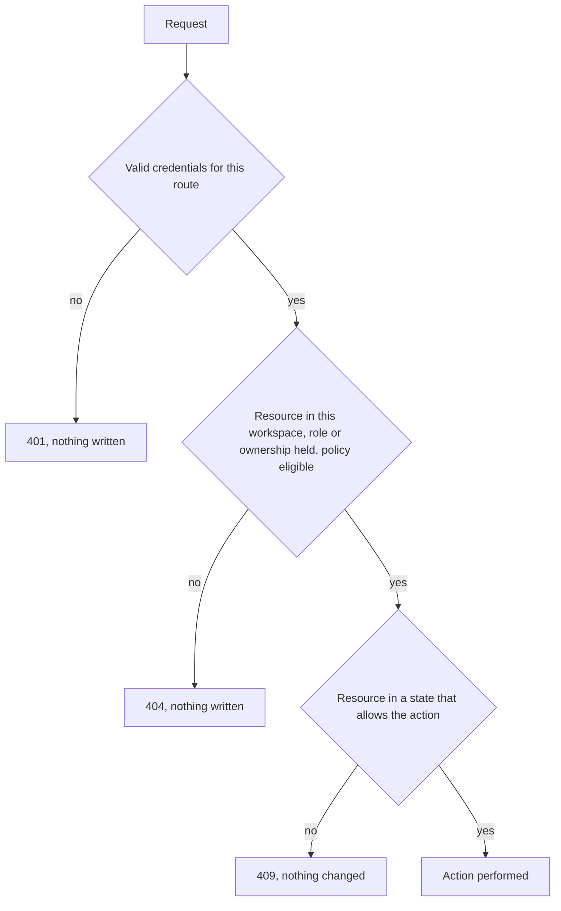

# Authentication and authorization

Who can call Tether, how each credential is validated, which roles may do what, and how workspace isolation is enforced. For security reviewers, operators who provision identities, and engineers integrating a calling application. The threat analysis is in the [security model](security-model.md).

## Two credentials on the tasks routes

Submitting, reading and cancelling a run use two credentials together. Each proves something different.

| Credential | Carried in | Proves |
|---|---|---|
| Workspace API key | `X-API-Key` header | Which **calling application** is asking. The key maps to exactly one workspace and a set of allowed agents. |
| End-user token (JWT) | `Authorization: Bearer <token>` | Which **person** the work is for, their roles, and that a platform-controlled issuer vouches for them. |

Neither is enough alone. The API key's workspace must equal the token's `workspace` claim. The requester stored on the run is the token's subject, and the agent is resolved on the server from the key's bindings. Nothing in the request body identifies anyone.

The approval and ops routes take the token only. A calling application's API key does not reach them.

## Route audiences

Every route is bound to one audience. The expected audience comes from the route, never from the token.

| Audience | Routes | Credentials |
|---|---|---|
| `tether-tasks` | `POST /v1/tasks/runs`, `GET /v1/tasks/runs/{run_id}`, `POST /v1/tasks/runs/{run_id}/cancel` | Token and API key |
| `tether-approvals` | `POST /v1/approvals/{approval_id}/{action}`, `GET /v1/approvals/approvals`, `GET /v1/approvals/approvals/{approval_id}`, `GET /v1/approvals/runs/{run_id}` | Token |
| `tether-ops` | `POST /v1/ops/ledger/{ledger_id}/reconcile`, `GET /v1/ops/runs/{run_id}`, `POST /v1/ops/runs/{run_id}/cancel` | Token |

`/healthz` and `/readyz` are unauthenticated and return no data. In `prod` the `api` serves no OpenAPI schema; `dev` and `test` serve `/openapi.json`. Full route behaviour is in the [API reference](../reference/api.md).

A token issued for one audience is refused on another. A person who holds approver and reconciler roles needs a token for each audience.

## How a token is validated

Validation runs before the handler. Any failure is `401` and nothing is evaluated or written. The checks, in order (`src/tether/identity/jwt.py`):

1. The token parses, and its header carries `alg` and a string `kid`. Only `EdDSA` and `RS256` are accepted. `none` and HMAC algorithms are never accepted.
2. The unverified payload names a non-empty `workspace` and a string `iss`. These claims are used only to choose which issuer record to load. Nothing is trusted yet.
3. An issuer record exists for that workspace and `iss`, and:
   - its pinned algorithm equals the header's `alg`;
   - its allowed audiences include this route's audience;
   - it holds a public key under that `kid`.
4. The signature verifies with that public key and the pinned algorithm. The payload's `iss` equals the issuer's, and `aud` is this route's audience.
5. `exp` is required. `exp` and `nbf` are checked with 10 seconds of leeway. `iss`, `aud` and `sub` are required.
6. `aud` is exactly the route's audience, as a string or a one-element list. A token that lists more than one audience is refused.
7. `sub` is a non-empty string.
8. `roles`, if present, is a list of strings. Absent means no roles.

The validated result is a principal: workspace, subject, roles and audience. Roles are valid only inside that workspace. The token itself is never stored. An optional `jti` is carried on the principal but is not used to detect replay.

A token has this shape (illustrative; the issuer is yours):

```json
{
  "iss": "https://issuer.example.com/ws-example/tether-approvals",
  "sub": "bob",
  "aud": "tether-approvals",
  "workspace": "ws-example",
  "roles": ["approver"],
  "exp": 1767229200
}
```

with a header of `{"alg": "EdDSA", "kid": "approvals-1"}`.

Tether imposes no maximum token lifetime and keeps no revocation list. Use short lifetimes. See [what is not defended](security-model.md#what-tether-does-not-defend).

A rejected request returns:

```http
HTTP/1.1 401 Unauthorized
WWW-Authenticate: Bearer

{"detail": "invalid or missing credentials"}
```

The response does not say which check failed, and the credentials are never logged or echoed.

## API keys

A raw key looks like `tak_<key_id>_<52 characters>`. The key ID is lowercase letters, digits and dashes (at most 63 characters, starting with a letter or digit). The secret is 32 random bytes encoded in base32.

- **Issue.** `tether apikey new <key_id> --agent <agent-id>` prints the raw key once, with the entry to paste into the bootstrap file. Repeat `--agent` to bind several agents. Tether does not store or log the raw key.
- **Store.** Only the key ID, a 16-byte salt and `SHA-256(salt || secret)` are stored, in the bootstrap file and the `api_keys` table.
- **Verify.** The secret is parsed, hashed with the stored salt and compared in constant time. An unknown key ID does the same work against a dummy salt, so timing does not reveal which key IDs exist.
- **Bind.** A key belongs to one workspace and to a set of agents (`api_key_agents`).

Agent resolution on `POST /v1/tasks/runs`:

| Request | Result |
|---|---|
| `agent_id` omitted, key bound to one agent | That agent. |
| `agent_id` omitted, key bound to several agents | `422`: the caller must name one. |
| `agent_id` names a bound agent | That agent. |
| `agent_id` names an agent the key is not bound to | `401`. |
| The bound agent does not exist in the workspace | `404`. |

## Roles

Four roles are fixed by name in the core. The requester is not a role: it is whoever submitted the run.

| Who | Audience | Core role | Also required | May |
|---|---|---|---|---|
| Requester | `tether-tasks` | none | Must be the run's requester for read and cancel | Submit a run. Read and cancel their own runs. |
| Approver | `tether-approvals` | `approver` | A role named by the tool's `require_approval` rule; not the run's requester | List and read approvals they are eligible for. Read run evidence for a run with such an approval. Approve or reject. |
| Reconciler | `tether-ops` | `reconciler` | A role listed in the workspace's `reconciliation.reconciler_roles`; not the run's requester | Resolve an `indeterminate` ledger entry with a justification. |
| Auditor | `tether-ops` | `auditor` | None | Read any run of the workspace. |
| Workspace admin | `tether-ops` | `workspace_admin` | None | Read any run of the workspace. Cancel any run of the workspace. |

Approval and reconciliation are authorized in two steps, both against roles in the validated token:

1. **The core role.** The token must carry `approver` or `reconciler`. This is fixed in code.
2. **The policy rule.** Under the workspace's active policy version, a role of the person must be named by the matching rule (`approver_roles`) or by `reconciliation.reconciler_roles`, and the person must not be the run's requester. The subject comparison is by `sub`, so the issuer must give each person a stable, unique subject.

A person with only a custom role such as `senior-approver` fails step 1, whatever the policy says. The policy that defines these rules is in [policy](../governance/policy.md), the approval mechanics in [approvals](../governance/approvals.md) and reconciliation in [unknown outcomes](../governance/unknown-outcomes.md).

If the process's loaded policy version differs from the workspace's active version, the human routes answer `503` ("policy is reloading") and change nothing.

Run views are read-only and return masked data. Inspecting a run through the approvals audience (run evidence) or the ops audience (the oversight view) also writes an access event. Access events are best effort; see [secrets and data handling](secrets-and-data-handling.md#what-a-person-can-see).

## Order of checks and status codes

Authorization runs in a fixed order: audience and token, workspace, role or ownership, policy eligibility, then the state of the resource.



| Status | Meaning here |
|---|---|
| `401` | Missing, malformed or invalid credentials, a wrong audience, an agent outside the key's binding, or the development shortcut used in `prod`. Raised before the handler. |
| `404` | The resource does not exist **for this caller**: unknown id, another workspace, a missing role, an ineligible approver or reconciler (including the requester), or a run that belongs to another requester. |
| `409` | The caller is eligible but the state forbids the action: an approval that is no longer pending, closed or expired; a run that is stopped or terminal; a ledger entry resolved with a different outcome. |
| `422` | The request is malformed: an unknown outcome, a missing justification, an ambiguous agent. |
| `503` | The policy version is reloading. |

The code returns no `403`. A `403` would confirm that a resource exists. Eligibility is checked before state, so an ineligible caller learns nothing about a resource's state through `409`.

An approval decision, as an approver would send it (illustrative):

```http
POST /v1/approvals/<approval-id>/approve
Authorization: Bearer <approver-token>
Content-Type: application/json

{"reason": "Checked the ticket and the target service."}
```

```json
{"id": "<approval-id>", "status": "approved"}
```

## Workspace isolation

Isolation is enforced in the data-access layer, not by convention in each handler.

- Handlers never receive a raw database session. They receive repositories that cannot be constructed without a `WorkspaceScope` taken from the principal's workspace.
- Every read is filtered by that workspace. Every write is stamped with it, and a write for another workspace raises an error.
- The worker derives its scope from the job and checks it against the run's workspace.
- Composite foreign keys in the schema stop a child row from referencing a run in another workspace.
- The only unscoped queries are the credential lookups that establish the workspace (issuer by workspace and `iss`, API key by key ID) and the worker's job lease.

PostgreSQL row-level security is not used, so the scoped repositories and the composite keys are the whole defence. See [ADR-0013](../adr/0013-identity-trust-boundary-workspace-isolation.md) and [data model](../architecture/data-model.md).

## The development identity shortcut

For development, a request with **no** `Authorization` header may state its identity instead, but only when `TETHER_ENV` is `dev` or `test`:

- a `dev_identity` object in the body, for submit, cancel, approval decisions, reconciliation and admin cancel;
- a `dev_workspace_id` query parameter, for `GET /v1/tasks/runs/{run_id}`, which then reads any run of that workspace.

Rules that hold in every environment:

- A request with an `Authorization` header is always authenticated with real credentials. Whatever it states in its body is ignored, and an invalid token is `401`, never a fallback to the shortcut.
- In `prod` the shortcut is never accepted. A request without credentials is `401`.
- The shortcut only produces the same principal that real credentials produce, so every later check (roles, policy eligibility, ownership) is identical.
- It does not exist on the read-only approval routes or on `GET /v1/ops/runs/{run_id}`. They accept real credentials only.

The module (`src/tether/api/dev_identity.py`) ships in the production image and is inert outside `dev` and `test`. The development token issuer (`tools/dev_issuer/`) is not part of any image.

## Provisioning identities

There is no administrator HTTP API ([ADR-0014](../adr/0014-bootstrap-config-no-admin-api.md)). Identities live in the bootstrap file, which an operator reviews and applies with `tether bootstrap apply <path>` (run as the migrator database role), then restarts the processes. The file holds no secrets:

- **Agents.** Each names the workload it runs.
- **Issuers.** Per workspace: an id, the `iss` value, the audiences it may sign for, a pinned algorithm (`EdDSA` by default, or `RS256`) and one or more PEM **public** keys by `kid`. A file that contains private key material, a key of the wrong type for the algorithm, or a duplicate issuer is rejected.
- **API keys.** Key ID, salt, hash and bound agents. A key bound to an agent the workspace does not define is rejected.
- **Policy.** Rules, permissions and eligible roles ([policy](../governance/policy.md)).

Applying the file also removes issuers and API keys that were dropped from it.

```yaml
workspaces:
  - id: ws-example
    agents:
      - id: agent-example
        workload: incident_remediation
    issuers:
      - id: tasks
        iss: https://issuer.example.com/ws-example/tether-tasks
        audiences: [tether-tasks]
        algorithm: EdDSA
        public_keys:
          tasks-1: |
            -----BEGIN PUBLIC KEY-----
            <PEM public key>
            -----END PUBLIC KEY-----
      - id: approvals
        iss: https://issuer.example.com/ws-example/tether-approvals
        audiences: [tether-approvals]
        algorithm: EdDSA
        public_keys:
          approvals-1: |
            -----BEGIN PUBLIC KEY-----
            <PEM public key>
            -----END PUBLIC KEY-----
    api_keys:
      - key_id: app-example
        salt: <32 hexadecimal characters>
        secret_hash: <64 hexadecimal characters>
        agents: [agent-example]
```

Use a separate issuer, and separate signing keys, for each audience. An issuer that can sign for `tether-tasks` and `tether-approvals` lets one compromised key reach both. Each setting and the full file format are in [configuration](../operations/configuration.md); key rotation is in [key lifecycle](../operations/key-lifecycle.md).

## Limits

- Production runs need a human end-user token. There are no production service principals.
- Issuer keys are static bootstrap entries. There is no OIDC discovery or JWKS fetching.
- No token revocation, no maximum token lifetime, no replay detection.
- A requester's roles are fixed at submission. Exposure after a mid-run revocation is bounded by approval expiry and the run deadline.
- The full set of routes, audiences, identities and workspaces is exercised by an authorization matrix test, including a second workspace. That suite is implemented and tested; it is not yet part of the stated guarantees ([guarantees](../guarantees.md)).

## Related

- [Security model](security-model.md)
- [Secrets and data handling](secrets-and-data-handling.md)
- [Policy](../governance/policy.md) and [approvals](../governance/approvals.md)
- [API reference](../reference/api.md)
- [ADR-0013](../adr/0013-identity-trust-boundary-workspace-isolation.md) and [ADR-0014](../adr/0014-bootstrap-config-no-admin-api.md)
