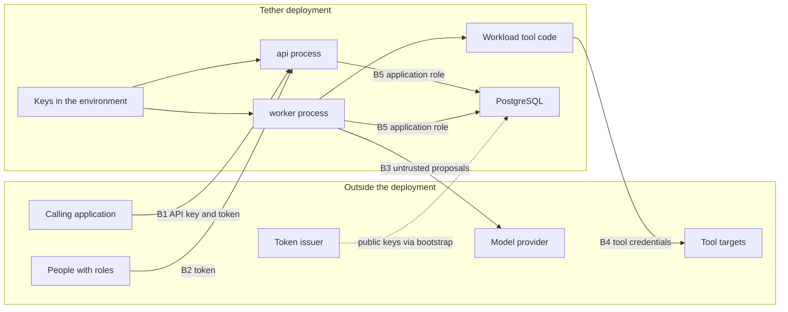

# Security model

The assets Tether protects, who is trusted with what, where the trust boundaries are, which threats Tether addresses and which it does not. For security reviewers, operators and anyone deciding whether Tether fits their risk. Start here, then read [authentication and authorization](authentication-and-authorization.md) and [secrets and data handling](secrets-and-data-handling.md).

Tether has not had an independent security audit or penetration test. Its controls are checked by its own automated tests ([validation](../validation.md)); that is evidence, not assurance from a third party. Read the second half of this page with the same weight as the first.

## What Tether protects

| Asset | Why it matters | Main controls |
|---|---|---|
| The ability to cause a side effect | A model proposal that reaches a real system can change money, data or infrastructure. | One governed path from proposal to dispatch: deny-by-default policy, exact-action approval, a committed ledger entry before every send. |
| Approvals | An approval is a person's consent to one exact call. Reuse for another call defeats it. | Keyed call hash over the exact call; approver role, policy eligibility, never the requester; expiry. |
| Audit integrity | The record of what was decided and done is the evidence after an incident. | Per-run HMAC chain written in the same transaction as the state it describes; append-only grants on the event rows. |
| Credentials and keys | They authenticate callers and bind approvals and audit events. | Secrets only from the environment; public keys and hashes only in configuration; registered secret values and credential shapes scrubbed from logs. |
| Workspace data | Runs, task input, tool outputs and approvals belong to one workspace. | Every request-path query after authentication is workspace-scoped; anything out of scope is `404`. The credential lookups, the worker's queue queries and the LangGraph checkpoints (keyed by run) are not scoped. |

## Actors and how far each is trusted

| Actor | Trust | What it can do | What it cannot do |
|---|---|---|---|
| Calling application | Authenticated, not trusted with identity | Submit runs for the workspace and agents its API key is bound to, carrying a requester's token. | Choose another workspace or agent, state a requester or role, or call the approval and ops routes with its tasks credentials. |
| Requester | The human subject of the token | Submit, read and cancel their own runs. | Approve or reconcile their own run, or read anyone else's run. |
| Approver | Role `approver` plus a policy rule | Approve or reject a pending call whose rule names one of their roles. | Decide their own run's approval, or act without the policy rule. |
| Reconciler | Role `reconciler` plus a policy setting | Resolve an `indeterminate` ledger entry with a justification. | Reconcile their own run's entry. |
| Auditor | Role `auditor` | Read any run of the workspace, masked. | Change anything. |
| Workspace admin | Role `workspace_admin` | Read and cancel any run of the workspace. | Approve, reconcile, or administer the platform. |
| Token issuer | Trusted, platform-controlled | Mint tokens for the audiences and workspace its bootstrap entry allows. | Nothing outside that entry. A compromised issuer is not defended (below). |
| The model | **Untrusted output** | Propose tool calls and text. | Supply policy inputs, approve, choose its own tools, or reach a tool without a decision and a ledger entry. |
| Tool code and its targets | Workload code is trusted but not sandboxed | Run in the worker process with the worker's privileges. | Nothing enforces limits on it (below). |
| Operator and database administrator | Trusted | Hold the keys, the bootstrap file and the database credentials. | Tether does not defend against them. |

There is no platform-administrator HTTP API and no runtime administrator role. Platform administration is the operator's access to the deployment, the bootstrap file and the `tether` CLI ([ADR-0014](../adr/0014-bootstrap-config-no-admin-api.md)).

## Trust boundaries

| Boundary | What crosses it | What is checked |
|---|---|---|
| B1 Calling application to `api` | Run submission | Workspace API key and an end-user token for the `tether-tasks` audience; both must name the same workspace. |
| B2 People to `api` | Approvals, reconciliations, cancellations, reads | A token whose audience equals the route's audience, then workspace, role and policy eligibility. |
| B3 Model output to the worker | Tool names, arguments, text | Nothing from the model is trusted. Calls are validated against the registered tool schema; policy inputs never come from the model. |
| B4 Worker to a tool target | The side effect | Only for a call with a committed ledger entry whose call hash matches the arguments being sent. |
| B5 Processes to PostgreSQL | All state | The least-privilege application role: no DDL; no `DELETE` on the `tether` schema tables; `audit_events` and `access_events` are insert-only for it; the bootstrap tables (workspaces, agents, issuers, API keys, policy versions) are read-only. `audit_heads` is updatable by it, because each append moves the head. The role can delete from and update the `langgraph` checkpoint schema, which holds unmasked model proposals. |

The `api` and `worker` processes are one trust domain. They share the image, the environment and the database role. Tether does not isolate one from the other.

Anyone holding the application role's credential, including tool code, can update approval, ledger, run, job and audit-head rows. Only audit and access events are insert-only. Row integrity outside the audit chain rests on application code, the terminal-status trigger and constraints, not on database permissions or a MAC.

## Threats Tether addresses

"Stated guarantee" means the behaviour is in the [guarantees page](../guarantees.md) with its evidence. "Implemented and tested" means code and tests exist, but the wording has not been accepted into the guarantees page; do not rely on it as a guarantee.

| Threat | Control | Where | Status |
|---|---|---|---|
| Model output steers a policy decision | Policy inputs are trusted runtime values only: the requester snapshot taken from the validated token, the run's agent and workspace, and the tool registry's risk and required permissions. Arguments and model text are never inputs. Deny by default; a high-risk tool is never `allow`, and worker startup refuses a policy that allows one. | `src/tether/policy/engine.py`, `src/tether/runtime/graph.py`, [ADR-0009](../adr/0009-policy-engine-current-policy.md), [ADR-0020](../adr/0020-v1-policy-engine-contract.md) | Stated guarantee |
| An approval is used for a different call | The approval binds an HMAC-SHA-256 call hash over the canonical envelope: workspace, run, agent, tool, tool version, validated arguments and declared preconditions. The worker dispatches only arguments whose hash equals the ledger entry's. | `src/tether/core/hashing.py`, `src/tether/worker/handlers/execute_tool.py`, [ADR-0010](../adr/0010-keyed-canonical-call-hash.md) | Stated guarantee |
| The pre-dispatch re-check misses a lapsed or changed approval | Before creating the ledger entry, authorization re-evaluates current policy and re-checks the approval's status, hash and expiry. A refusal creates no entry and sends nothing. | `src/tether/runtime/graph.py` | Implemented and tested. A refusal writes no audit event of its own. |
| Self-approval or self-reconciliation | Eligibility requires a role named by the policy rule and refuses the run's requester by subject. | `src/tether/policy/engine.py`, `src/tether/api/routers/approvals.py`, `src/tether/api/routers/ops.py` | Stated guarantee |
| Cross-workspace access | Repositories cannot be built without a workspace scope; every request-path read after authentication is filtered and every write stamped; composite foreign keys enforce consistency in the schema. Out-of-scope lookups return `404`, never `403`. The credential lookups, the worker's queue queries and the LangGraph checkpoints (keyed by run) are outside this scoping. | `src/tether/storage/scope.py`, `src/tether/storage/repos/base.py`, [ADR-0013](../adr/0013-identity-trust-boundary-workspace-isolation.md) | Stated guarantee. The full route-by-role-by-workspace matrix is implemented and tested. |
| Forged, wrong-audience or expired credentials | Signature check against the workspace's issuer public key; algorithm pinned per issuer (`EdDSA` or `RS256`); the audience comes from the route; `exp` required; every failure is `401` before any state change. | `src/tether/identity/jwt.py`, `src/tether/authz/deps.py` | Stated guarantee |
| A stolen token used on a more powerful route | Three audiences, each bound to its routes. A `tether-tasks` token is refused by the approval and ops routes. | `src/tether/authz/deps.py` | Stated guarantee |
| The calling application invents an approver | Roles come only from validated tokens. A token is accepted only from an issuer configured for that workspace and audience. Request bodies are ignored when an `Authorization` header is present. | `src/tether/identity/jwt.py`, `src/tether/authz/deps.py` | Stated guarantee |
| A leaked API key used alone | The tasks routes also need a valid end-user token for the same workspace. Keys are stored as a salted hash and compared in constant time. | `src/tether/identity/api_keys.py` | Stated guarantee |
| Tampering with run history | Each run has an HMAC chain over its events (including the previous event's MAC), keyed outside the database. The application role can only insert audit events. `tether audit verify` recomputes the chain and checks the persisted head; the `audit_chain_valid` flag in the run views recomputes the chain but does not check the head. | `src/tether/audit/chain.py`, `src/tether/storage/migrations/versions/rev_0002_core_schema.py`, [audit](../governance/audit.md) | Stated guarantee, with the limits below |
| A crashed or replayed run adopts stale state | Every adoption of persisted state recomputes the call hash under the run's binding key. A mismatch is a `REPLAY_DIVERGENCE` event and the run fails closed: no further model call, authorization or send. Nothing is rewritten to make hashes match. When the pinned tool version is no longer resolvable the hash cannot be recomputed; adoption then only requires the stored rows to agree, and nothing is sent. | `src/tether/runtime/graph.py`, [ADR-0003](../adr/0003-authoritative-tables-checkpoint-progress-cache.md) | Stated guarantee |
| A stale or second driver changes a run | Per-run advisory lock plus a fencing token on every run-driver write. Worker outcome transactions are serialised by row locks and conditional updates. The LangGraph checkpoint is not fenced; a resulting fork fails closed as a replay divergence. A terminal status can never change (database trigger). | `src/tether/runtime/driver.py`, [ADR-0005](../adr/0005-run-driver-mutex-and-fencing.md) | Stated guarantee |
| Secrets and payloads in logs, traces and metrics | Registered secret values and credential shapes are scrubbed; top-level log fields named like payloads or credentials are dropped, while nested fields and free-text messages are only pattern-scrubbed; tracebacks carry no locals; metric labels are bounded. The migrator database URL and the change-control GitHub token are not registered with the scrubber. | `src/tether/observability/logging.py`, [secrets and data handling](secrets-and-data-handling.md) | Stated guarantee. End-to-end masking of a `Sensitive` field in every stored row is implemented and tested. |
| The development identity shortcut used in production | It works only with no `Authorization` header and `TETHER_ENV` of `dev` or `test`. In `prod` such a request is `401`. | `src/tether/api/dev_identity.py` | Tested. The stated authentication guarantee depends on it; the explicit-environment behaviour is implemented and tested but not yet stated as a guarantee. |
| Starting production by accident in a development configuration | `TETHER_ENV` has no default; absent or invalid, `tether-api`, `tether-worker` and the database-connecting `tether` commands exit with status 2 (`tether apikey new` and `--help` need no environment). The scripted model provider is refused outside `dev` and `test`. `prod` serves no OpenAPI schema. | `src/tether/settings.py`, `src/tether/providers/factory.py` | Implemented and tested |

Some of these controls overlap on purpose. A request that mixes workspaces is refused at the API-key check, which requires the key's workspace to equal the token's, and the scoped repositories would still filter by the token's workspace if that check were missed.

## What Tether does not defend

These are limits, not gaps awaiting a fix in this document. Plan around them.

**A steered model.** Tether does not detect prompt injection. A model that has been manipulated can propose any call its agent's tools allow. Tether's defence is structural: the proposal still passes policy, an approval where required, and the ledger. An approved call is executed as approved, so an approver is the last control. The approver sees masked arguments, without the tool's risk level or the model's rationale.

**A compromised database administrator or key holder.** Anyone who holds the audit key can recompute a valid chain after editing events. Anyone with the superuser or migrator role can edit tables, the policy version, issuers and API-key hashes. Anyone with the binding key can compute call hashes. `tether bootstrap apply` is a high-trust operation: it writes issuers, API-key hashes and policy, so whoever can run it, or edit the file it applies, controls who can authenticate and what is allowed. Tether trusts the operator.

**A compromised token issuer.** Issuer public keys are static entries in the bootstrap file. A party that can sign with an issuer's private key can mint any subject and role for the audiences that issuer is allowed to sign for. Use a separate issuer, with separate keys, for each audience.

**Subject naming across issuers.** The requester and the approver or reconciler are compared by `sub` alone, across issuers. Every issuer must use one shared, unique subject namespace for each person. If the tasks and approvals issuers name the same person differently, the self-approval and self-reconciliation checks do not apply to that person.

**Untrusted tool code.** Workload tools run inside the worker process, with its environment, which includes the database URL and the audit and binding keys. Tether does not sandbox them, limit their network access or restrict their imports. Only install workloads you trust as you trust the core. A tool's timeout bounds one send; it does not contain a hostile tool.

**Deleting the end of an audit chain.** The chain detects modification and reordering of events within a run. It does not detect deletion of its last events by someone who also rewrites the persisted head, nor deletion of a whole run. The audit log is not WORM storage and there is no cross-run chain. Events written before the MAC version was introduced (version 1) do not cover their timestamp; new events (version 2) do. Rows in other tables (runs, approvals, ledger entries) are protected by grants, constraints and application code, not by a MAC.

**Token replay and revocation.** Tokens are bearer credentials. Tether does not use token identifiers to detect replay, enforce a maximum token lifetime or check revocation. A stolen token works until its `exp`. A requester's roles are snapshotted at submission; revoking a person mid-run is not guaranteed to stop the run, and exposure is bounded by approval expiry and the run deadline.

**Production service principals and OIDC.** Production runs require a human end-user token. There are no service principals for production and no OIDC discovery or JWKS fetching; keys are rotated by editing the bootstrap file and restarting.

**Network exposure.** The `api` binds `0.0.0.0:8080` by default and serves plain HTTP. Restrict who can reach it and terminate TLS at the network layer. TLS, network policy, request size limits and rate limiting are the deployment's job; Tether has no rate limiting, lockout or request-size limit. Every run view recomputes the run's audit chain, so its cost grows with the run's length. `/healthz` and `/readyz` are unauthenticated and return no data.

**Sensitive data the author did not mark.** Masking applies to fields marked `Sensitive`. An unmarked field is stored and shown as is. Unmasked arguments exist in the LangGraph checkpoint and in the `execute_tool` job payload, and Tether does not encrypt them at rest. Task input, approval reasons, reconciliation justifications and a tool's `ToolNotApplied` reason are free text and are not masked. So is a run's `outcome_summary`: in a successful run it is the model's final text, and in a failed run it can carry a Tether-authored provider message such as `model call failed: the model provider rate-limited the request` (it can include an HTTP status code, never the provider's response body) or a tool or configuration reason. Non-sensitive tool output placed in model context leaves the deployment when a hosted provider is used.

**Isolation below the application.** Workspace isolation is enforced in the application's data-access layer and by composite foreign keys. PostgreSQL row-level security is not used. A bug that bypasses the scoped repositories would bypass isolation. The LangGraph checkpoints are keyed by run only and are not workspace-scoped; they are reached only by the run driver, never by a request handler.

**Exactly-once side effects.** A non-idempotent write is sent at most once and an unknown outcome is `indeterminate`; Tether does not claim exactly-once for arbitrary APIs. An idempotent re-send relies on the target honouring the idempotency key. See [side effects and the ledger](../governance/side-effects-and-ledger.md).

**Read-only probes.** Automatic verification runs a tool's declared read-back. Tether cannot prove that a third-party probe only reads. A wrong read-back verdict is final: a person cannot override a `verified_applied` or `verified_not_applied` resolution.

**Duplicate submissions.** Submitting the same task twice creates two runs. Tether does not deduplicate submissions.

**Smaller limits.**

- The development identity module ships in the production image and is inert outside `dev` and `test`.
- Tether does not check at startup that the audit keys and binding keys are different material. Keep them independent.
- Access events (who inspected a run) are best effort: they are written asynchronously, can be lost on a crash or a full buffer, and cover only approver and ops run inspections.
- Waiting-status transitions are not audited.
- No data-retention policy exists and nothing is deleted.
- The live model and live external-write checks ran once on one host and are not part of continuous integration, which uses mocked transports for the OpenAI adapter and the GitHub client.

## What the operator must do

Tether's controls assume a deployment that does these things. [Deployment](../operations/deployment.md) and [production configuration](../operations/production-configuration.md) give the steps.

- Restrict access to the `api`'s port and terminate TLS in front of it. Keep PostgreSQL off untrusted networks, and require TLS to it (for example `?sslmode=verify-full` in the database URL) unless the link is a trusted local network.
- Use the separate application and migrator database roles, and give the processes only the application role.
- Deliver keys and credentials through a secret mechanism, never the image or the repository, and keep the audit and binding key families separate ([key lifecycle](../operations/key-lifecycle.md)).
- Mount a reviewed bootstrap file containing public keys and hashes only.
- Issue short-lived tokens, with separate issuers and keys per audience.
- Protect and back up the database; a restore that loses committed state is a recovery discontinuity ([PostgreSQL recovery](../operations/postgres-recovery.md)).
- Review every workload before installing it, and mark sensitive fields in its tool schemas.

## Related

- [Authentication and authorization](authentication-and-authorization.md)
- [Secrets and data handling](secrets-and-data-handling.md)
- [Guarantees](../guarantees.md) and [validation](../validation.md)
- [Policy](../governance/policy.md) and [approvals](../governance/approvals.md)
- [Audit](../governance/audit.md)
